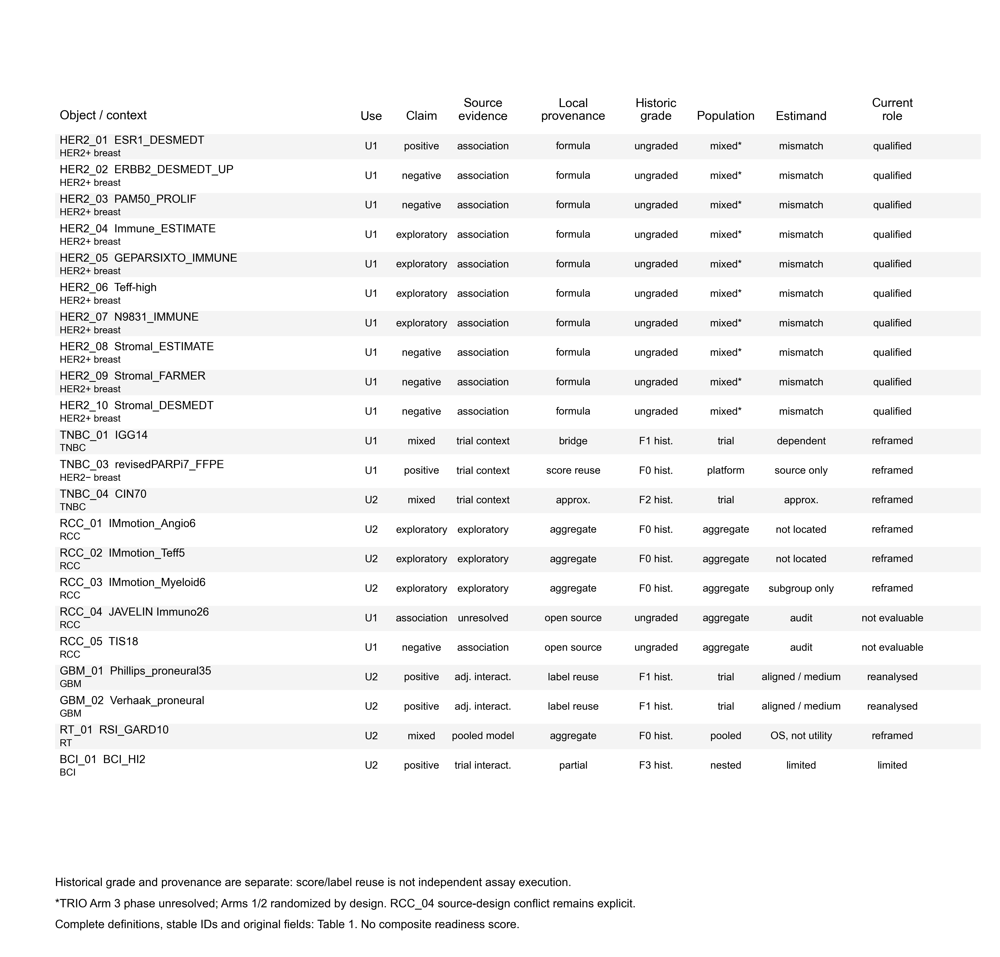
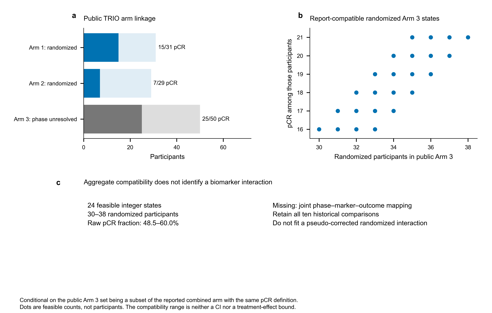
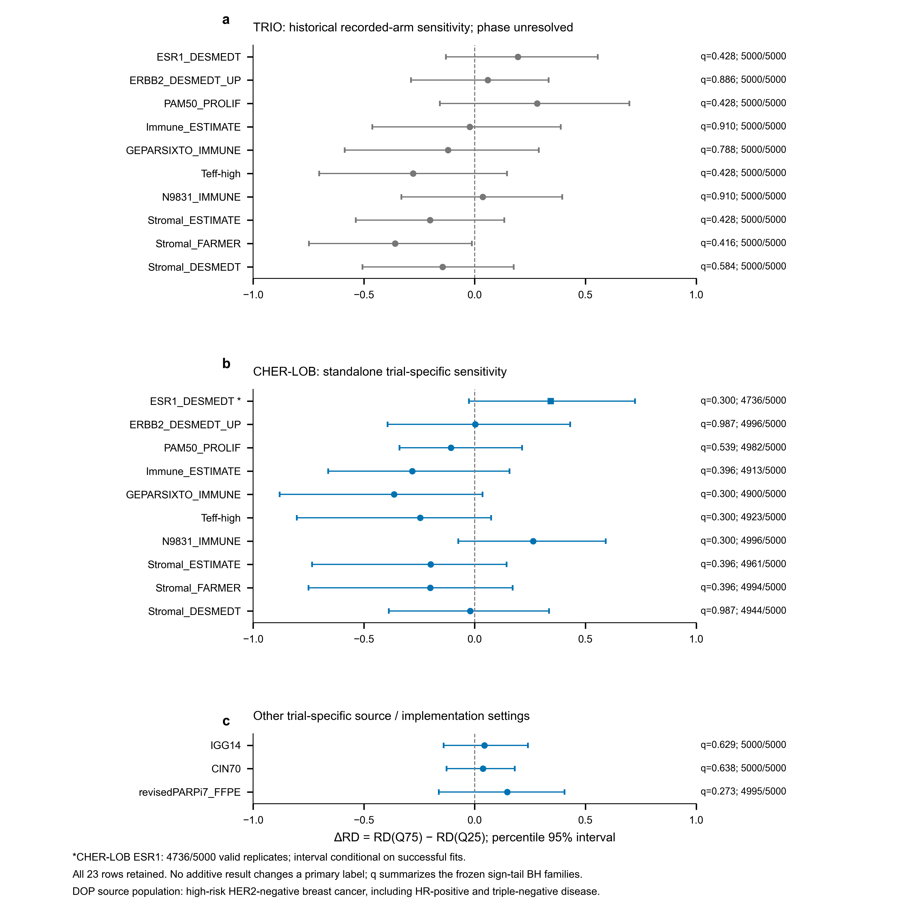
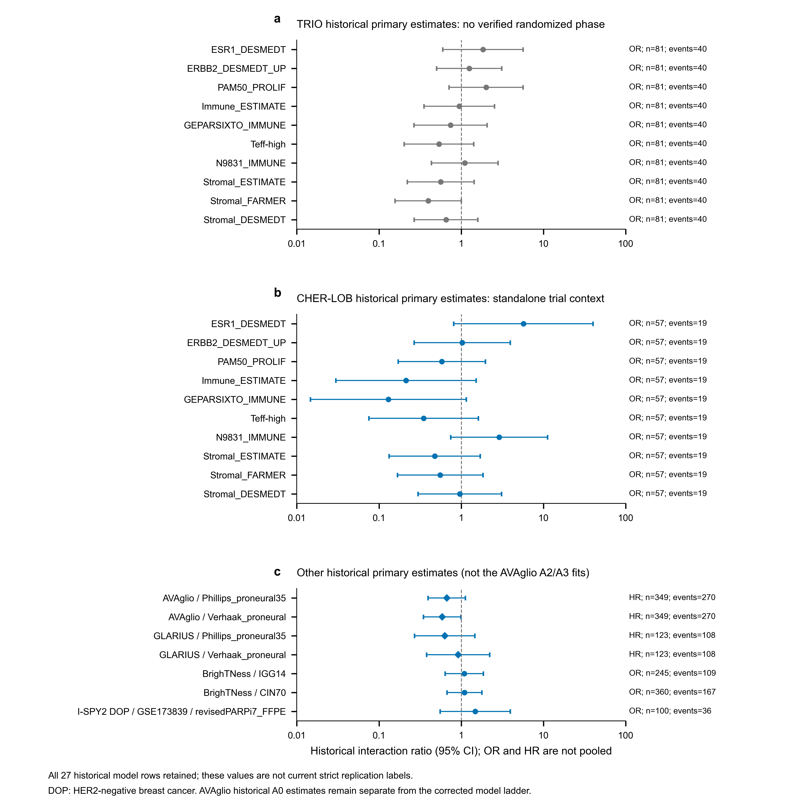

# From reproducible estimates to defensible inference: a provenance-aware audit and targeted reanalysis of oncology transcriptomic biomarkers

**Authors:** `[[AUTHORS_PENDING]]`  
**Affiliations:** `[[AFFILIATIONS_PENDING]]`  
**Corresponding author:** `[[CORRESPONDING_AUTHOR_PENDING]]`  

## Abstract

### Background

A reproducible biomarker estimate can still answer a different clinical question from the original claim. We examined how source provenance, implementation, analysis population and target estimand affect the interpretation of transcriptomic biomarker reanalyses.

### Methods

This finite retrospective empirical methods study audited 22 claim–estimand objects selected from 28 historical candidates. Original use, source evidence, implementation provenance and current inferential role were recorded separately. We retained 27 historical interaction models and 23 absolute-effect sensitivities. Targeted numerical work was restricted to recoverable AVAglio population and model rules; TRIO-US B07 was assessed for allocation-phase identifiability without constructing a guessed randomized subset.

### Results

Fifteen objects had local numerical records and seven were source-audit objects. AVAglio provided a recoverable correction pathway: the expression-evaluable, IDH1-wild-type and fixed complete-case sets contained 349, 339 and 333 participants. On the shared 333-participant set, clinical adjustment changed the Phillips interaction hazard ratio from 0.612 to 0.516 (adjusted 95% confidence interval [CI] 0.292–0.912) and the Verhaak ratio from 0.513 to 0.460 (0.261–0.811). These were same-trial specification comparisons, not independent validations. TRIO provided an information-limited pathway: Arms 1 and 2 were randomized by design, but Arm 3 participant-level allocation phase remained unresolved. Conditional aggregate constraints allowed 30–38 randomized Arm 3 participants and a raw complete-response proportion of 48.5–60.0%, without identifying a biomarker interaction. Ten historical TRIO models therefore retained only a restricted inferential role. None of 13 historical cross-trial units met every current verified-strict prerequisite; the replication proportion was not estimable.

### Conclusions

Recoverable discrepancies justify versioned numerical reanalysis; unresolved identity justifies a documented limit on inference. The contribution is a provenance-aware correction workflow illustrated by two complementary cases, not a field-wide biomarker failure rate or a new validation claim.

## Keywords

Transcriptomic biomarkers; treatment-effect modification; claim-estimand alignment; provenance; randomized trials; reproducibility

## Background

Transcriptomic signatures can describe tumour lineage, proliferation, immune activity, stromal composition and DNA-repair biology. Their clinical interpretation depends on the question being asked. Association with outcome among recipients of one therapy is not the same estimand as differential benefit between therapies, and neither is equivalent to the utility of a biomarker-guided treatment strategy.[1,2]

That distinction can be lost at several points. A candidate may be called predictive although only a treated-cohort association was estimated. A molecular analysis embedded in a randomized trial may include participants from different allocation phases. A score may be approximated while retaining the original assay name. A numerical estimate may therefore be reproducible while answering a different clinical question from the published claim. Prior oncology-wide work assessed treatment-by-biomarker interaction evidence for US Food and Drug Administration (FDA)-approved biomarkers.[3] We extend that methodological question to the links between transcriptomic claim provenance, executable implementation, recoverable analysis populations and the estimand evaluated in a secondary analysis.

We therefore defined a bounded empirical question: among a fixed set of oncology transcriptomic biomarker objects, how do published claims, source evidence, implementation, population identity and validation estimands align, and what happens when a discrepancy permits numerical reconstruction versus only inferential qualification? The study does not develop a response classifier, optimize a cut point, search for favourable biomarkers or estimate field-wide prevalence. Historical values remain visible even when their current interpretation changes.

## Methods

### Study design and chronological transparency

This was a finite retrospective empirical methods study with provenance auditing and targeted secondary reanalysis. The historical analyses were completed before the present protocol amendment and were not relabelled as prospectively registered. Before targeted execution, we froze the revised object hierarchy, the A0–A4 AVAglio model ladder, the TRIO stopping rule and the manuscript/figure architecture. Earlier files were retained as read-only numerical and writing history.

### Object hierarchy and selection

Five identifiers were maintained separately: report, `claim_estimand_id`, implementation, trial/population and statistical model. The 28 historical candidates formed a purposive lineage. The 22 core objects were fixed before the targeted analyses and retained without outcome-driven reselection; 15 had local numerical records. Candidate counts, objects and model rows were never combined into a screening denominator.

### Source-claim and implementation adjudication

Primary reports, available supplementary material, publisher corrections and repository records were reviewed for original use, evidence design, result wording, treatment comparison, endpoint, implementation and formal interaction evidence. Treatment-conditioned association (U1), differential treatment benefit (U2) and biomarker-guided strategy utility were kept separate. A tested candidate was not coded as a positive claim unless the source made a positive conclusion. The implementation taxonomy distinguished the exact original function (F0), a prespecified platform bridge preserving that function (F1), a source-compatible approximation (F2), a partial implementation with missing components (F3) and a non-executable assay (F4). Historical grades and formula-status records were retained rather than silently reassigned. Provenance was an orthogonal field: independent formula execution, author-released score reuse, deposited-label reuse, published aggregate evidence and partial assay abstraction were recorded separately. A historical F0 or F1 record describing a source definition, score or label did not establish independent execution of the original assay.

### TRIO population and identifiability audit

TRIO-US B07 evaluated neoadjuvant treatment in human epidermal growth factor receptor 2 (HER2)-positive breast cancer.[4] Public participant records were checked for unique linkage, treatment arm and outcome. Randomized-phase identity required an explicit source field or authoritative mapping. Trial design was used to identify Arms 1 and 2 as randomized-phase arms, but participant identifiers and row order were prohibited as evidence for splitting Arm 3. Aggregate constraints enumerated report-compatible integer combinations only. Because those combinations did not identify marker values, treatment contrasts or marker-by-treatment coefficients, no corrected randomized interaction or simulation was performed.

### AVAglio A0–A4 model ladder

For both source-deposited proneural labels, A0 was an unadjusted Cox marker, treatment and marker-by-treatment model in all 349 expression-evaluable participants. The endpoint was overall survival in months, with death coded 1 and censoring coded 0. Treatment was bevacizumab versus placebo, both added to radiotherapy and temozolomide; marker status was proneural versus non-proneural. Both treatment and marker were coded 1 for the first category. The exponentiated interaction coefficient is therefore the ratio of the bevacizumab-versus-placebo hazard ratio (HR) in proneural participants to that in non-proneural participants, rather than a subgroup treatment HR.

A1 applied the same model in 339 IDH1-wild-type participants. A2 applied the same unadjusted model after the frozen six-row literal-NA exclusion, yielding 333 participants. A3 used the identical 333 rows and adjusted for age, corticosteroid use, surgical status, sex, Karnofsky performance status, MGMT status, Mini-Mental State Examination (MMSE), recursive partitioning analysis (RPA) class and World Health Organization (WHO) performance status. Age was continuous and categorical covariates were indicator encoded. The source's explicit MGMT “Missing” category was retained and was distinct from the literal-NA rule. A4 retained all 339 IDH1-wild-type rows using explicit missing levels and a fixed `lifelines` Cox ridge penalty of 0.01. No hyperparameter tuning or outcome-guided model selection was performed.

Interaction HRs used Wald 95% confidence intervals (CIs) and two-sided nominal P values. The ten related label-by-specification rows describe model sensitivity and were not used as independent confirmatory tests or a selection family. The two new A2 fits were checked for design rank and convergence, assessed using rank-transformed proportional-hazards diagnostics and influence summaries, and independently recomputed with Efron ties in R `survival::coxph`. These checks evaluate numerical implementation and model assumptions on the same data. Targeted AVAglio analyses were run in Python 3.13.7 with lifelines 0.30.3, pandas 2.3.3, NumPy 2.3.3 and SciPy 1.16.2.

### Historical model and absolute-effect records

The 27 historical primary interaction rows and 23 binary absolute-effect rows were imported without overwriting historical coefficients, intervals, P values, q values, multiplicity families or primary labels. For each binary sensitivity, predicted probabilities came from the frozen logistic model `logit P(Y=1)=β0+βT T+βM M+βTM TM`, where Y=1 denoted pathologic complete response (pCR), T represented the recorded trial-specific treatment contrast and M was the frozen standardized marker. Delta risk difference was `ΔRD=RD(Q75)−RD(Q25)`, with `RD(m)=P(Y=1|T=1,m)−P(Y=1|T=0,m)`. Q25 and Q75 were the fixed marker quartiles in each pooled analytic sample. Positive ΔRD indicates a larger model-predicted absolute treatment contrast at Q75 than at Q25.

Five thousand nonparametric replicates resampled within each recorded treatment arm and refitted that logistic model while keeping marker quartiles fixed. Rank-deficient, non-convergent or non-finite fits were excluded from interval calculation. Percentile 95% intervals used the valid replicates; the historical technical rule required at least 95% valid replicates for PASS, 90% to less than 95% for a conditional interval, and less than 90% for non-estimability. The recorded two-sided bootstrap sign-tail probability was `min{1, 2 min[(1+n≤0)/(Bvalid+1), (1+n≥0)/(Bvalid+1)]}`. This is a tail summary of the bootstrap distribution, not a permutation test generated under a null hypothesis. Benjamini–Hochberg correction was retained within five frozen trial–contrast families (Supplementary Table S3). Model-specific random seeds were deterministically derived from the phase seed 20260913, trial and object identifier. Recorded-arm resampling does not establish randomized assignment, and additive-scale results could not promote a primary label.

### Cross-trial eligibility

All 13 historical units and three dependency-cluster identifiers were retained. Current verified-strict membership required a phase-verified target population, sufficient estimand compatibility, an independent evaluation and a recoverable source-defined positive decision path. Eligibility did not depend on whether the local P value was significant. Units failing any prerequisite remained visible with a reason; no smaller post hoc denominator was created.

### Figure construction and validation

Four main figures and three supplementary figures were generated directly from source tables without statistical refitting. Main figures define the finite study boundary, separate evidence dimensions across all 22 objects, display the AVAglio specification ladder and enumerate the TRIO aggregate compatibility states. Supplementary figures retain all 13 historical cross-trial units, 23 absolute-effect rows and 27 historical primary model rows. A source-to-panel record defines the permitted use of each result. Figures use a white background, colour-blind-safe marks, black text, editable vector PDF/SVG and 600-dpi PNG output, generated with Matplotlib 3.10.7. Checks verify row counts, arithmetic transformations, source hashes and unchanged historical labels; visual review of the rendered figure PDFs is separate from numerical checking.

### AI-assisted research and manuscript support

Artificial intelligence (AI) and large language model (LLM) tools supported file comparison, code checking, document organization and language refinement under human review. Before submission, the authors must confirm the exact tool name, model or version, creator, access dates, specific research and writing uses, and the accountable human verification pathway: `[[AI_DISCLOSURE_PENDING]]`. No AI system qualifies as an author or replaces scientific accountability.

## Results

### A finite purposive study boundary

The historical lineage contains 28 purposively assembled candidates. Twenty-two form the core claim–estimand audit set, 15 have local numerical records, and those records contain 27 historical marker-by-treatment model rows. These are different counting units rather than a sequential screening flow (Fig. 1a; Table 1). Six partially recoverable candidates remained in lineage but were not promoted to the 22-object set. The sampling process was informed by known literature and data availability and cannot support a prevalence estimate for transcriptomic biomarkers as a field.

Each object retains a stable `claim_estimand_id`. Original use, claim polarity, source design, implementation, population, estimand compatibility and current role are separate fields (Fig. 1b and Fig. 2). No composite readiness score was calculated. Across the 22 objects, current roles were 10 population-unverified, seven role-reframed, two targeted-reanalysis, two not-currently-evaluable and one implementation-limited.

**Figure 1 | A finite object set supports two complementary correction pathways.** **a,** Historical candidates, claim–estimand objects, objects with local estimates and primary model rows are different counting units, not sequential systematic-review steps. **b,** Published use, source evidence, implementation, analysis population, estimand and current role are kept separate. **c,** AVAglio supports numerical reconstruction from recoverable source rules, whereas TRIO requires inferential qualification because participant allocation phase cannot be mapped. Historical computations remain available in both pathways.

**Abbreviations:** IDH1, isocitrate dehydrogenase 1.

### Published response association, formal interaction and external validation were non-equivalent evidence layers

Fourteen objects originated as treatment-conditioned response or outcome associations (U1), whereas eight concerned differential treatment benefit (U2). The sources contained positive, negative, exploratory and mixed conclusions. The complete historical interaction estimates are retained in Supplementary Fig. S3. A positive U1 result did not become U2 evidence merely because a later common interaction model was applied; similarly, a non-significant interaction did not prove biological irrelevance or equivalence. Figure 2 preserves use, claim polarity, source evidence, implementation provenance, historical grade, population and estimand as distinct dimensions.

The ten TRIO signatures illustrate this distinction. ESR1_DESMEDT supported a positive treatment-conditioned response association rather than an exact treatment-selection interaction. Five signatures had published negative response-association interpretations, and four were exploratory or lacked a signature-specific positive conclusion.[4] The historical application of a common interaction model therefore did not constitute ten attempts to replicate ten equivalent positive predictive claims.

Other source audits produced object-specific boundaries. CIN70 had a negative prespecified dichotomous evaluation for specific veliparib–carboplatin response while a continuous response association was described separately.[5] RevisedPARPi7 used an author-released score in a 105-participant expression/score subset, with five unknown outcomes leaving 100 model-complete rows. This resource contains high-risk HER2-negative breast cancer, including hormone-receptor-positive and triple-negative disease; the legacy TNBC_03 identifier is retained for linkage, not used as a population definition.[6] The IMmotion150 publisher correction changed the Figure 2n top Myeloid comparison to combination therapy versus atezolizumab monotherapy; it did not rewrite Angio or Teff results.[7,8] JAVELIN and related renal-cell-carcinoma signatures remained aggregate/source-audit objects in this project.[9,10] For RCC_04, a historical source-design label refers to randomized interaction, whereas the adjudicated claim record states that a formal interaction was not located. We therefore retain an unresolved source-evidence label rather than treat trial context as a verified interaction test. Genomic-adjusted radiation dose (GARD) provided endpoint-specific pooled interaction evidence across heterogeneous cohorts rather than a single randomized trial,[11] and Breast Cancer Index (BCI) had positive randomized-source interaction evidence although the simplified local ratio was not an executable reconstruction of the calibrated assay.[12,13]

**Figure 2 | Source evidence and implementation provenance are separate across all 22 objects.** Each row retains a stable legacy identifier; columns show original use, source-claim polarity, evidence design, local provenance, historical grade, analysis-population status, estimand compatibility and current role. Categories do not form a composite score. A positive claim is positive for its original use, not automatically evidence of treatment selection. Historical F0/F1 labels are retained but may describe source definitions, scores or labels rather than independent assay execution. For AVAglio, “aligned / medium” separates the reconstructed source-trial estimand from medium-compatible GLARIUS transportability. “Not located” records an unlocated formal interaction, not proof that one never occurred; RCC_04 retains conflicting historical design and adjudication labels. The DOP resource is displayed as HER2-negative breast cancer despite its legacy TNBC_03 identifier. “Mixed” population refers to unresolved Arm 3 allocation phase, not uncertainty about Arms 1 and 2.

**Abbreviations:** U1, treatment-conditioned association; U2, differential treatment benefit; F0–F4, implementation taxonomy defined in Methods; GBM, glioblastoma; HER2, human epidermal growth factor receptor 2; OS, overall survival; RCC, renal cell carcinoma; RT, radiotherapy; TNBC, triple-negative breast cancer.

### AVAglio separated population restriction from model adjustment

The AVAglio source and repository records supported a five-specification ladder for both Phillips and Verhaak proneural labels (Fig. 3). A0 used all 349 expression-evaluable participants; A1 excluded 10 IDH1-mutant tumours, leaving 339; A2 excluded a fixed six rows with a literal unavailable value in a required clinical covariate, leaving 333, but remained unadjusted; A3 applied the source-listed clinical adjustment on the same 333 rows; A4 used all 339 IDH1-wild-type rows with explicit missing levels and a fixed ridge penalty. The later erratum supplied an omitted repository link but did not alter the reported population or interaction result.[14,15]

On the shared 333-participant set, with 260 deaths, the A2 unadjusted Phillips interaction was HR 0.612 (95% CI 0.355–1.056; P=0.0777), and the Verhaak interaction was HR 0.513 (0.296–0.891; P=0.0178) (Fig. 3b,c; Supplementary Table S1). The A3 adjusted estimates were HR 0.516 (0.292–0.912; P=0.0229) and HR 0.460 (0.261–0.811; P=0.00728), respectively. From A1 to A2, HR ratios were 0.980 and 0.990; from A2 to A3 on the same rows they were 0.843 and 0.896. In this dataset, the fixed six-row exclusion caused little movement, whereas clinical adjustment produced a larger numerical shift. These differences are descriptive specification sensitivity, not additive causal contributions, and crossing P=0.05 does not imply that two specifications differ significantly.

The A4 estimates were similar—HR 0.540 (0.311–0.940; P=0.0292) for Phillips and HR 0.480 (0.276–0.834; P=0.00926) for Verhaak—but A4 differs from A3 in population, missing-category handling and penalization. It is therefore displayed as an alternative branch rather than a fourth single-factor step (Fig. 3d). Source-deposited subtype labels were reused; the original NanoString centroid pipelines were not independently re-executed.[14] All AVAglio estimates are same-trial specification analyses, not independent validations.

**Figure 3 | AVAglio separates population restriction from model adjustment.** **a,** Expression-evaluable, IDH1-wild-type and fixed complete-case populations contain 349/270, 339/265 and 333/260 participants/deaths. **b,c,** Points and bars show Phillips and Verhaak interaction HRs and Wald 95% CIs for A0–A3; the logarithmic axis and dashed reference denote HR=1. A2 and A3 use the same 333 participants and differ in clinical adjustment. The interaction HR is the bevacizumab-versus-placebo HR in proneural participants divided by that in non-proneural participants, not a subgroup treatment HR. **d,** A3 circles and A4 diamonds compare the adjusted complete-case model with a separate 339-participant missing-category model with ridge penalty 0.01. A4 is not a fourth single-factor step. All models reuse source-deposited labels and constitute same-trial sensitivity analyses. Nominal two-sided P values and full numerical packets are reported in Supplementary Table S1; specification differences are not causal contributions from modelling decisions.

**Abbreviations:** CI, confidence interval; HR, hazard ratio; IDH1, isocitrate dehydrogenase 1.

### TRIO showed design-level partial identifiability without a corrected randomized interaction

The public TRIO linkage contained 110 unique rows: 31 in Arm 1, 29 in Arm 2 and 50 in Arm 3, with 15, seven and 25 pathologic complete responses, respectively. No raw randomized-phase field was present. Trial design identified Arms 1 and 2 as randomized-phase arms, whereas Arm 3 could include both direct-assignment and randomized participants. Thus, absence of a raw field did not make all 110 participants equally uncertain: Arms 1 and 2 were identifiable at the design level, but Arm 3 remained unresolved at the participant level.

The historical target comparison used Arm 1 (n=31) and all public Arm 3 records (n=50), with 40 responses. The report states that the first 20 participants were assigned directly to combined therapy and that 38 participants remained in the corresponding combined-treatment group after those participants were excluded.[4] Participant number and row order were not treated as phase labels. Under conditional integer constraints compatible with the public and reported aggregate counts, the randomized component of public Arm 3 could contain 30–38 participants and have a raw response proportion of 48.5–60.0% (Fig. 4b,c). This is a compatibility range, not a confidence interval, corrected treatment effect or marker-by-treatment interaction bound.

No pseudo-corrected TRIO model was fitted. The ten historical estimates remain available as computational history and scale sensitivity, but not as verified randomized treatment-effect-modification estimates. CHER-LOB remains a separate randomized-context analysis; loss of a verified TRIO anchor does not invalidate CHER-LOB within-trial calculations.[16]

**Figure 4 | TRIO aggregate compatibility does not identify a randomized biomarker interaction.** **a,** Total bar lengths show public participants in each arm; darker portions show pCR counts, annotated as events/participants. Arms 1 and 2 arise from the randomized phase by design; Arm 3 participant-level phase remains unresolved. **b,** The 24 dots enumerate feasible pairs of randomized participant counts and pCR counts within public Arm 3, conditional on those 50 records being a subset of the reported combined arm and using the same pCR definition. The report supplies 38 randomized participants with 21 pCRs and 20 directly assigned participants with nine pCRs. Dots are feasible aggregate states, not patient observations. **c,** Feasible randomized counts span 30–38 and feasible raw pCR fractions span 48.5–60.0%. This compatibility range is neither a confidence interval nor a treatment-effect or marker-by-treatment interaction bound. Without the joint phase–marker–outcome mapping, all ten historical comparisons remain visible but no pseudo-corrected randomized interaction is fitted.

**Abbreviations:** pCR, pathologic complete response.

### Historical cross-trial labels were separated from current verified eligibility

The historical replay retained all 13 units and their three dependency clusters: ten HER2 units sharing the TRIO–CHER-LOB pair, two glioblastoma units sharing AVAglio–GLARIUS, and one IGG14–BrighTNess unit (Supplementary Fig. S1a; Supplementary Table S2). These units are not 13 independent replications. Historical membership and current verified-strict membership are now separate fields.

All ten HER2 units are descriptive because the TRIO anchor population is unresolved. The two glioblastoma units compare a reconstructed AVAglio anchor with a medium-transportability GLARIUS analysis rather than an exact replication.[17] The IGG14 analysis is dependent on a report already containing the BrighTNess resource.[18] No unit currently satisfies all prerequisites for a verified-strict denominator. The current strict proportion is therefore not estimable (Supplementary Fig. S1b). The 13-unit historical replay describes the analysis history; it supplies neither a current replication numerator nor an eligible denominator.

### Absolute-effect sensitivities did not promote a primary label

All 23 historical binary absolute-effect rows were retained. Ten TRIO rows are population-unverified scale sensitivities; ten CHER-LOB rows remain standalone trial-specific sensitivities, with ESR1_DESMEDT retaining its historical technical warning because 4,736 of 5,000 bootstrap replicates were valid. The remaining three rows retain trial-specific source and implementation boundaries.

Stromal_FARMER was the sole nominal additive result: delta risk difference −0.360, 95% bootstrap interval −0.748 to −0.013, sign-tail P=0.0416 and within-family q=0.416. None of the 23 results was multiplicity robust. This nominal result arose from the assignment-unverified TRIO population and did not promote a frozen primary label (Supplementary Fig. S2; Supplementary Table S3).

## Discussion

Biomarker reanalysis requires both a reproducible estimate and a defensible link to the clinical question. In this selected set, TRIO required qualification of the historical inference because allocation phase was unresolved, whereas AVAglio permitted numerical reconstruction because the relevant population and model rules were recoverable. Their shared methodological contribution is a record of how a source discrepancy changes the use of an estimate, with the historical computation retained for inspection (Fig. 1c).

Predictive-biomarker trial designs distinguish outcome association from differential treatment benefit,[1,2] and the audit of approved oncology biomarkers by Vivot and colleagues showed why formal treatment-by-biomarker evidence warrants direct scrutiny.[3] Our object-level assessment adds implementation and population identity to that question. A later common interaction model can evaluate a new treatment-selection hypothesis, but its result must be distinguished from replication of an original treatment-conditioned association. That distinction changes how the TRIO signature analyses are interpreted without overturning the response associations reported by the original investigators.[4]

The TRIO case identifies the information needed before its comparative interpretation can be restored. The trial report documents the directly assigned lead-in and subsequent randomized comparison,[4] while the public linkage lacks an authoritative mapping of Arm 3 participants to those phases. Aggregate compatibility constraints describe feasible response proportions but leave the joint distribution of allocation phase, marker and outcome unidentified. They therefore cannot recover the target interaction coefficient. A participant-level phase mapping supplied by the trial custodians would permit the randomized analytic population to be defined before any marker model was refitted; until then, the historical estimates retain a restricted descriptive role.

The AVAglio case shows how apparent disagreement with a published result can arise from model specification. Sandmann and colleagues reported an adjusted proneural-by-treatment interaction and called for independent validation.[14] Our unadjusted Phillips A2 result (P=0.0777) and adjusted A3 result (P=0.0229) arise on the same 333 participants. Their comparison separates the observed numerical movement accompanying clinical adjustment from that accompanying the six-row restriction. Adjustment changes the conditional model being estimated, so the larger movement cannot by itself be assigned to confounding or to a causal effect of a modelling decision. Reusing deposited subtype labels and the same trial allows specification assessment; the non-identical GLARIUS setting answers a transportability question with different conditions.[17]

Absolute-effect analysis contributes a further question: whether a treatment contrast changes across marker values on the probability scale. The 23 sensitivities preserve that distinction from the primary logistic interaction. The sole nominal ΔRD has a within-family q value of 0.416 and arises in the assignment-unverified TRIO set. It is an example of scale-dependent uncertainty under a restricted population interpretation. Likewise, a missing eligible cross-trial denominator represents an evaluability gap; it supplies no estimate of the frequency of successful or unsuccessful replication.

For future secondary analyses, the practical sequence is to identify the original intended use and comparison, verify the assay implementation, recover the analysis population, and specify the target estimand before fitting a model. A recoverable discrepancy supports a versioned reanalysis with old and new estimates shown together. An unresolved discrepancy supports a documented limit on interpretation. Recording the reason at the object level preserves the distinction among source-negative findings, implementation limits, population uncertainty and statistical imprecision, and makes subsequent corrections traceable.

The study has several limits. The purposive object set is concentrated in a few trial resources and cannot estimate field prevalence. Historical results were visible before the protocol amendment, so the design is a retrospective audit with a dated targeted-analysis addendum. Source adjudication is context dependent; its inter-reviewer reliability has not been quantified. TRIO participant-level phase remains unrecoverable in the public linkage. AVAglio uses deposited labels, A4 changes several specification dimensions, and GLARIUS is an imperfect transportability match. Two renal-cell-carcinoma objects retain unresolved provenance, and the simplified local Breast Cancer Index implementation does not reproduce the calibrated assay. Small binary cohorts and failed bootstrap fits also limit precision; the CHER-LOB ESR1_DESMEDT interval is conditional on valid resamples. These limitations constrain both object-specific inference and generalization of the framework.

The next decisive empirical step would be an independent application of the evidence-alignment record to a new, prospectively defined trial-resource set. Reviewers would adjudicate source use, implementation, population and estimand without seeing local interaction results, then compare agreement and the consequences of resolved discrepancies under a prespecified analysis plan. Within the present cases, the priority is authoritative TRIO phase mapping and independent execution of the AVAglio classifier in a compatible trial with the same endpoint and treatment comparison. These tests would assess whether the framework improves reproducibility of interpretation and whether a treatment-selection claim generalizes beyond the source trial.

## Conclusions

Computational reproducibility and defensible clinical inference require separate, versioned records. In this selected object set, source provenance, implementation, population identity and estimand alignment changed what historical results could support without deleting unfavourable results or creating a post hoc denominator. The practical output is an auditable evidence-alignment framework and two complementary correction pathways, not a field-wide biomarker failure rate.

## List of abbreviations

AI, artificial intelligence; BCI, Breast Cancer Index; BH, Benjamini–Hochberg; CI, confidence interval; ΔRD, difference in risk differences; FDA, US Food and Drug Administration; GARD, genomic-adjusted radiation dose; GBM, glioblastoma; HER2, human epidermal growth factor receptor 2; HR, hazard ratio; IDH1, isocitrate dehydrogenase 1; LLM, large language model; MGMT, O6-methylguanine-DNA methyltransferase; MMSE, Mini-Mental State Examination; pCR, pathologic complete response; RCC, renal cell carcinoma; RD, risk difference; RPA, recursive partitioning analysis; RT, radiotherapy; TNBC, triple-negative breast cancer; WHO, World Health Organization.

## Declarations

### Ethics approval and consent to participate

This retrospective secondary study used published evidence and public de-identified resources. The original studies reported their ethics and consent procedures. The institution-specific determination for the present secondary analysis must be supplied by the responsible author: `[[ETHICS_DETERMINATION_PENDING]]`.

### Consent for publication

`[[CONSENT_FOR_PUBLICATION_PENDING]]`

### Availability of data and materials

The disclosure-safe derived tables, provenance records, code and manifests are prepared for release; restricted participant-level inputs are not redistributed. The authors must approve the public repository, archived DOI, licence and any access restrictions: `[[DATA_CODE_REPOSITORY_PENDING]]`.

### Competing interests

`[[COMPETING_INTERESTS_PENDING]]`

### Funding

`[[FUNDING_PENDING]]`

### Authors' contributions

`[[CREDIT_PENDING]]`

### Acknowledgements

`[[ACKNOWLEDGEMENTS_PENDING]]`

## References

1. Mandrekar SJ, Sargent DJ. Clinical trial designs for predictive biomarker validation: one size does not fit all. J Biopharm Stat. 2009;19:530–542. doi:10.1080/10543400902802458.
2. Renfro LA, Mallick H, An MW, Sargent DJ, Mandrekar SJ. Clinical trial designs incorporating predictive biomarkers. Cancer Treat Rev. 2016;43:74–82. doi:10.1016/j.ctrv.2015.12.008.
3. Vivot A, Boutron I, Béraud-Chaulet G, Zeitoun JD, Ravaud P, Porcher R. Evidence for treatment-by-biomarker interaction for FDA-approved oncology drugs with required pharmacogenomic biomarker testing. Sci Rep. 2017;7:6882. doi:10.1038/s41598-017-07358-7.
4. Hurvitz SA, Caswell-Jin JL, McNamara KL, Zoeller JJ, Bean GR, Dichmann R, et al. Pathologic and molecular responses to neoadjuvant trastuzumab and/or lapatinib from a phase II randomized trial in HER2-positive breast cancer (TRIO-US B07). Nat Commun. 2020;11:5824. doi:10.1038/s41467-020-19494-2.
5. Wolf DM, Yau C, Sanil A, Glas A, Petricoin E, Wulfkuhle J, et al. DNA repair deficiency biomarkers and the 70-gene ultra-high-risk signature as predictors of veliparib/carboplatin response in the I-SPY 2 breast cancer trial. NPJ Breast Cancer. 2017;3:31. doi:10.1038/s41523-017-0025-7.
6. Pusztai L, Yau C, Wolf DM, Han HS, Du L, Wallace AM, et al. Durvalumab with olaparib and paclitaxel for high-risk HER2-negative stage II/III breast cancer: results from the adaptively randomized I-SPY2 trial. Cancer Cell. 2021;39:989–998.e5. doi:10.1016/j.ccell.2021.05.009.
7. McDermott DF, Huseni MA, Atkins MB, Motzer RJ, Rini BI, Escudier B, et al. Clinical activity and molecular correlates of response to atezolizumab alone or in combination with bevacizumab versus sunitinib in renal cell carcinoma. Nat Med. 2018;24:749–757. doi:10.1038/s41591-018-0053-3.
8. McDermott DF, Huseni MA, Atkins MB, Motzer RJ, Rini BI, Escudier B, et al. Publisher Correction: Clinical activity and molecular correlates of response to atezolizumab alone or in combination with bevacizumab versus sunitinib in renal cell carcinoma. Nat Med. 2018;24:1941. doi:10.1038/s41591-018-0235-z.
9. Motzer RJ, Robbins PB, Powles T, Albiges L, Haanen JB, Larkin J, et al. Avelumab plus axitinib versus sunitinib in advanced renal cell carcinoma: biomarker analysis of the phase 3 JAVELIN Renal 101 trial. Nat Med. 2020;26:1733–1741. doi:10.1038/s41591-020-1044-8.
10. Braun DA, Hou Y, Bakouny Z, Ficial M, Sant’Angelo M, Forman J, et al. Interplay of somatic alterations and immune infiltration modulates response to PD-1 blockade in advanced clear cell renal cell carcinoma. Nat Med. 2020;26:909–918. doi:10.1038/s41591-020-0839-y.
11. Scott JG, Sedor G, Ellsworth P, Scarborough JA, Ahmed KA, Oliver DE, et al. Pan-cancer prediction of radiotherapy benefit using genomic-adjusted radiation dose (GARD): a cohort-based pooled analysis. Lancet Oncol. 2021;22:1221–1229. doi:10.1016/S1470-2045(21)00347-8.
12. Sgroi DC, Carney E, Zarrella E, Steffel L, Binns SN, Finkelstein DM, et al. Prediction of late disease recurrence and extended adjuvant letrozole benefit by the HOXB13/IL17BR biomarker. J Natl Cancer Inst. 2013;105:1036–1042. doi:10.1093/jnci/djt146.
13. Bartlett JMS, Sgroi DC, Treuner K, Zhang Y, Ahmed I, Piper T, et al. Breast Cancer Index and prediction of benefit from extended endocrine therapy in breast cancer patients treated in the Adjuvant Tamoxifen-To Offer More? trial. Ann Oncol. 2019;30:1776–1783. doi:10.1093/annonc/mdz289.
14. Sandmann T, Bourgon R, Garcia J, Li C, Cloughesy T, Chinot OL, et al. Patients with proneural glioblastoma may derive overall survival benefit from the addition of bevacizumab to first-line radiotherapy and temozolomide: retrospective analysis of the AVAglio trial. J Clin Oncol. 2015;33:2735–2744. doi:10.1200/JCO.2015.61.5005.
15. Erratum: Patients with proneural glioblastoma may derive overall survival benefit from the addition of bevacizumab to first-line radiotherapy and temozolomide: retrospective analysis of the AVAglio trial. J Clin Oncol. 2016;34:3113. doi:10.1200/JCO.2016.69.6674.
16. Guarneri V, Dieci MV, Frassoldati A, Maiorana A, Ficarra G, Bettelli S, et al. Prospective biomarker analysis of the randomized CHER-LOB study evaluating dual anti-HER2 treatment with trastuzumab and lapatinib plus chemotherapy as neoadjuvant therapy for HER2-positive breast cancer. Oncologist. 2015;20:1001–1010. doi:10.1634/theoncologist.2015-0138.
17. Weller J, Zeyen T, Schäfer N, Schaub C, Potthoff AL, Steinbach JP, et al. The proneural subtype is not associated with survival benefit from bevacizumab in newly diagnosed glioblastoma: a secondary analysis of the GLARIUS trial. J Neurooncol. 2023;164:749–755. doi:10.1007/s11060-023-04470-9.
18. Conte B, Brasó-Maristany F, Hernández AR, Pascual T, Villacampa G, Schettini F, et al. A 14-gene B-cell immune signature in early-stage triple-negative breast cancer (TNBC): a pooled analysis of seven studies. EBioMedicine. 2024;102:105043. doi:10.1016/j.ebiom.2024.105043.

## Table and additional file legends

**Table 1 | Claim–estimand characteristics and current roles of 22 selected biomarkers.** The table retains stable claim–estimand and legacy identifiers, signature, original clinical use and claim polarity, source evidence design, implementation provenance, historical grade, analysis-population status, estimand compatibility and current role. Derived display labels are paired with the unchanged full historical fields; unresolved and use-specific qualifications are not collapsed into assay failure. This is a purposive set and is not representative of transcriptomic biomarkers as a field. Current roles do not overwrite historical results or source conclusions. U1 denotes treatment-conditioned association; U2 denotes differential treatment benefit.

**Abbreviations:** U1/U2, treatment-conditioned association/differential treatment benefit; F0–F4, implementation classes defined in Methods; HER2, human epidermal growth factor receptor 2; TNBC, triple-negative breast cancer; RCC, renal cell carcinoma; GBM, glioblastoma; RT, radiotherapy; PARP, poly(ADP-ribose) polymerase; VEGF, vascular endothelial growth factor; TKI, tyrosine kinase inhibitor. Full stable claim–estimand identifiers are retained in the accompanying machine-readable table.

**Supplementary Table S1 | AVAglio A0–A4 model ladder.** Population, missing-data handling, adjustment, penalization and inferential role are shown for each source-deposited proneural label. A2 and A3 use the same fixed 333 participants but differ in clinical adjustment; A4 is a separate 339-participant penalized sensitivity specification. Additional file 1: Additional_file_1_AVAglio_A0_A4.csv (CSV).

**Supplementary Table S2 | Historical and current cross-trial eligibility for 13 units.** Historical decision labels, dependency clusters, current population and estimand qualifications, and current verified-strict eligibility are displayed together. Historical membership is preserved without constructing a new post hoc denominator; the current strict replication proportion is not estimable. Additional file 2: Additional_file_2_cross_trial_eligibility.csv (CSV).

**Supplementary Table S3 | Binary absolute-effect sensitivities for 23 historical model rows.** Delta risk differences, bootstrap intervals, sign-tail P values, within-family multiplicity results, diagnostics and current inferential roles are retained. Additive-scale sensitivity results do not change the frozen primary interaction labels, and the single nominal result is not multiplicity robust. Additional file 3: Additional_file_3_absolute_effect_sensitivity.csv (CSV).

## Supplementary figures

**Supplementary Figure S1 | Dependent historical units are not a current strict-replication denominator.** **a,** All 13 historical units remain in three clusters: ten TRIO–CHER-LOB, two AVAglio–GLARIUS and one IGG14–BrighTNess. **b,** Population identity, estimand compatibility, evaluation independence and a recoverable positive source decision path are current eligibility requirements. No unit meets every requirement; the proportion is not estimable rather than zero. Historical decision labels are retained in Supplementary Table S2.

**Abbreviations:** HR, hazard ratio.

**Supplementary Figure S2 | All 23 absolute-effect sensitivities retain uncertainty and technical qualifications.** **a,** Ten TRIO historical recorded-arm results do not establish randomized inference. **b,** Ten CHER-LOB rows remain standalone trial-specific sensitivities. **c,** Two BrighTNess and one DOP row retain their source and implementation boundaries. Points and bars show the difference in risk differences, RD(Q75)−RD(Q25), and percentile 95% bootstrap intervals at fixed pooled marker quartiles. Positive values denote a larger model-predicted treatment contrast at Q75. Annotations give the within-family BH q value and valid/requested replicates. Squares and an asterisk identify CHER-LOB ESR1_DESMEDT, with 4,736/5,000 valid fits; its interval is conditional on successful fits. The sign-tail statistic is not a null-generated permutation P value. All rows are retained, none is within-family multiplicity robust, and additive results cannot promote frozen primary labels. DOP includes high-risk HER2-negative hormone-receptor-positive and triple-negative breast cancer.

**Abbreviations:** BH, Benjamini–Hochberg; ΔRD, difference in risk differences; RD, risk difference.

**Supplementary Figure S3 | The complete historical numerical record is preserved without restoring superseded inferential labels.** **a,b,** Ten TRIO and ten CHER-LOB historical primary interactions remain visible with population-role qualifications. **c,** Seven other historical rows include four glioblastoma and three breast-cancer models. Points and bars show interaction ratios and historical 95% CIs on a logarithmic axis; the dashed line denotes 1. Circles represent ORs and diamonds HRs; those scales are not pooled. Annotations report participants and events. Historical AVAglio A0 estimates do not replace the A2/A3 model ladder in Figure 3. DOP denotes high-risk HER2-negative breast cancer. No point is a current verified-strict replication label.

**Abbreviations:** CI, confidence interval; HR, hazard ratio; OR, odds ratio.

