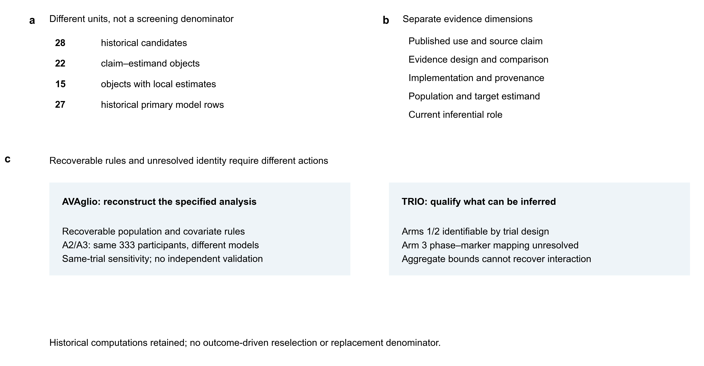
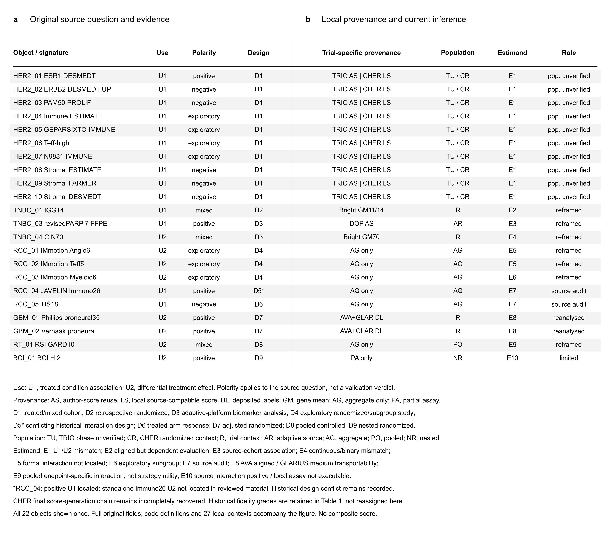
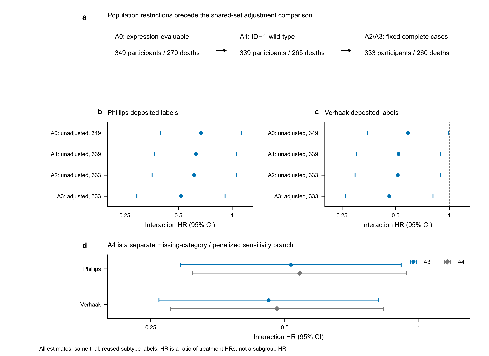
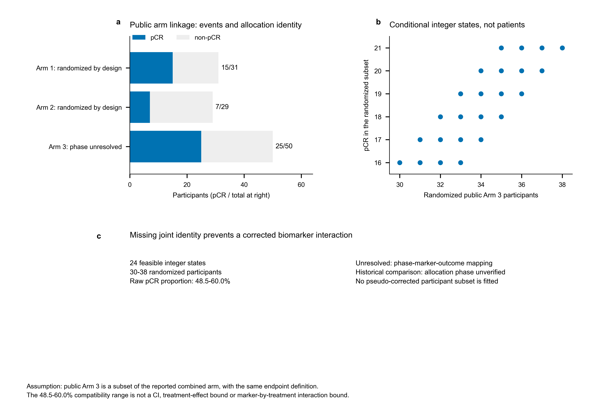

# From reproducible estimates to defensible inference: a provenance-aware audit and targeted reanalysis of oncology transcriptomic biomarkers

**Authors:** Zhi Chen¹, Teng Qi¹*  
**Affiliations:** ¹ School of Medicine, The Chinese University of Hong Kong, Shenzhen, China  
**Corresponding author:** * Teng Qi; email: tengqi@link.cuhk.edu.cn

**Author identifiers:** Zhi Chen: https://orcid.org/0009-0001-0072-5576; Teng Qi: https://orcid.org/0009-0007-7648-4776.  
**Document status:** v1.6.2 research-resource manuscript candidate (13 October 2026). Author information and declarations confirmed. Individual contribution roles are not yet documented; no journal submission has been made.

## Abstract

### Background

A reproducible biomarker estimate can answer a different clinical question from the original claim. We examined how source evidence, implementation provenance, analysis population and target estimand affect the interpretation of transcriptomic biomarker reanalyses.

### Methods

This finite retrospective empirical methods study audited 22 claim–estimand objects selected from 28 historical candidates. We linked original use and source conclusions to 27 trial-specific implementation records, retaining 27 historical interaction models and 23 absolute-effect sensitivities. Numerical work was restricted to recoverable AVAglio population and model rules. TRIO-US B07 was assessed for allocation-phase identifiability without constructing a guessed randomized subset.

### Results

Fifteen objects had local numerical records; seven remained source-only. Ten TRIO evaluations reused author scores, whereas the corresponding ten CHER-LOB evaluations used locally precomputed source-compatible scores with an incompletely recovered generating implementation. AVAglio expression-evaluable, IDH1-wild-type and fixed complete-case sets contained 349, 339 and 333 participants. On the shared 333-person set, the Phillips interaction hazard ratio changed from 0.612 unadjusted to 0.516 adjusted (95% confidence interval 0.292–0.912), and the Verhaak ratio from 0.513 to 0.460 (0.261–0.811). These were same-trial specification comparisons, not independent validations. TRIO Arms 1 and 2 were randomized by design, but Arm 3 participant-level phase remained unresolved. Conditional aggregate constraints permitted 30–38 randomized Arm 3 participants with a raw complete-response proportion of 48.5–60.0%; they did not identify a biomarker interaction. The ten historical TRIO models therefore retained restricted interpretation. The current strict cross-trial replication proportion was not estimable. Historical absolute-effect sign-tail and BH-transformed summaries were descriptive sensitivities without established confirmatory false-discovery-rate control.

### Conclusions

Recoverable discrepancies support versioned reanalysis; unresolved identity supports a documented limit on inference. These complementary cases illustrate a provenance-aware correction record, not a field-wide biomarker failure rate, independently validated audit tool or new treatment-selection claim.

## Keywords

Transcriptomic biomarkers; treatment-effect modification; claim-estimand alignment; provenance; randomized trials; reproducibility

## Background

Transcriptomic signatures describe tumour lineage, proliferation, immune activity, stromal composition and DNA-repair biology. Their clinical interpretation depends on the question being asked. Association with outcome among recipients of one therapy is not the same estimand as differential benefit between therapies, and neither establishes the utility of a biomarker-guided treatment strategy.[1,2]

The distinction can be lost when an association is described as predictive, a molecular subset is assumed to inherit the allocation properties of its parent trial, or an approximate score is presented under the original assay name. A later interaction estimate may be computationally reproducible while remaining misaligned with the source claim, actual assay implementation or intended randomized comparison. Prior oncology-wide work assessed treatment-by-biomarker evidence for US Food and Drug Administration-approved biomarkers.[3] The present study considers an additional chain: whether the source question, executable implementation, recoverable population and locally estimated quantity support the same interpretation.

We defined a bounded empirical question within a fixed set of oncology transcriptomic objects. How do these evidence dimensions align, and what should a secondary analysis do when a discrepancy permits numerical reconstruction versus only inferential qualification? AVAglio and TRIO illustrate those two pathways. We did not develop a response classifier, optimize a cut point, enlarge the object set to obtain favourable findings or estimate field-wide prevalence. Historical values remain available when their permissible interpretation changes.

## Methods

### Study design and chronological transparency

This was a finite retrospective empirical methods study with source auditing and targeted secondary reanalysis. Historical interaction models, absolute-effect sensitivities and AVAglio A0, A1, A3 and A4 specifications preceded the current research-plan revision. A dated RPv4 addendum defined the additional A2 complete-case unadjusted models before their execution and specified the TRIO stopping rule. Subsequent reviews in October 2026 refined provenance and statistical wording; RPv5 guided the bounded integration of those corrections. We did not relabel the entire project, its historical model ladder or its object selection as prospectively preregistered. The chronology and unchanged historical files are documented in Additional file 5.

### Object hierarchy and selection

Report, claim–estimand, implementation, trial/population and statistical-model identifiers were maintained separately. The 28 historical candidates formed a purposive lineage informed by known literature and data availability. Twenty-two core objects were retained without outcome-driven reselection; 15 had local numerical records. Six partially recoverable candidates remained in lineage rather than being promoted into the core set. Candidate counts, objects, repeated trial contexts and model rows were not combined into a screening denominator or treated as independent studies.

The main descriptive outputs were an object-level evidence record, a trial-specific implementation crosswalk and the two correction cases. These are methodological outputs rather than multiple confirmatory primary endpoints. We did not calculate a composite readiness score or an extrapolated prevalence from the selected objects.

### Source-claim and implementation adjudication

Primary reports, accessible supplementary material, publisher corrections and repository records were examined for original use, result wording, evidence design, comparison, endpoint and formal interaction evidence. Treatment-conditioned association (U1), differential treatment benefit (U2) and biomarker-guided strategy utility were kept distinct. A tested candidate was not classified as a positive claim unless the source made a positive conclusion. Polarity was scoped to the source question and could be positive, negative, exploratory, mixed, unresolved or not applicable.

Implementation provenance was assessed at the claim-by-trial level. Author-score reuse, deposited-label reuse, locally precomputed source-compatible scores, available-gene means and source-only aggregate evidence were recorded separately. Twenty-seven local model contexts were linked to implementation records; seven objects without local models retained source-only records. The crosswalk did not enlarge the 22-object denominator. The historical fidelity taxonomy distinguished an exact original function (F0), a prespecified platform bridge preserving that function (F1), a source-compatible approximation (F2), an incomplete implementation (F3) and a non-executable assay (F4). Historical grades and unresolved grade records were retained, not silently reassigned from a new provenance label. A source definition, score or label designated F0/F1 did not certify independent execution of the original assay.

TRIO loaders reused author-provided signature columns. CHER-LOB loaders read frozen locally precomputed scores and an audited sample linkage. Historical reports described rank-based ssGSEA-compatible scoring with weight 0.25 and a rank-mean sensitivity, but the final generating script and full configuration were not recovered in the bounded search. Verified score-file and loader identity were therefore separated from report-level evidence about generation. An early failed GSEApy run was not accepted as proof of successful final scoring. BrighTNess IGG14 used an available-gene mean of 11 of 14 genes; continuous CIN70 used a 70-gene mean. DOP reused the author-released revisedPARPi7 score. AVAglio and GLARIUS used deposited subtype labels. Original standardization was retained: pooled analytic-sample z scores with ddof=1 for TRIO, CHER-LOB and CIN70, and ddof=0 for IGG14 and DOP. Binary proneural labels were not z-standardized (Supplementary Table S4).

The source review was bounded. Additional file 4 records 12 targeted support clauses, their locations and access modes; most article passages were available as indexed primary text rather than unrestricted full-text retrieval. The local JAVELIN supplement was text-inspected and selected pages visually reviewed. Other retained source conclusions were explicitly identified as inherited adjudications. Neither article metadata, a file hash nor a targeted passage check was treated as a complete new semantic review of every cited report. Inter-reviewer reliability and external validation of the audit process were not assessed.

### TRIO population and identifiability audit

TRIO-US B07 evaluated neoadjuvant therapy in HER2-positive breast cancer.[4] Public records were checked for unique linkage, arm and pCR. Randomized-phase identity required an explicit field or an authoritative mapping. Design evidence identified Arms 1 and 2 as randomized-phase arms, but participant IDs and row order were prohibited as evidence for splitting Arm 3. An unresolved phase was not coded as confirmed non-randomized allocation.

We enumerated aggregate-compatible integer states conditional on the 50 public Arm 3 records being a subset of the reported 58-person combined arm with the same endpoint definition. The report supplied 38 randomized participants with 21 pCRs and 20 directly assigned participants with nine pCRs.[4] If r and s denote randomized participants and pCRs in public Arm 3, respectively, feasible states obeyed 30≤r≤38, 16≤s≤21 and r−17≤s≤r−14. These restrictions reflect available totals, not participant-level assignments. They do not identify the joint phase–marker–outcome distribution, so no corrected randomized interaction, guessed subset or simulated recovery was fitted. Table 3 and Additional file 3 retain the premises and all states.

### AVAglio population and model ladder

Both deposited proneural classifications were evaluated in A0–A4. Overall survival was measured in months, death=1 and censoring=0. T=1 denoted bevacizumab and T=0 placebo, each with radiotherapy and temozolomide. M=1 denoted deposited proneural; M=0 denoted every other deposited label, including Unclassified under the frozen local encoding. This is a declared local contrast, not evidence that every source-classifier or original-analysis decision was reconstructed. The exponentiated marker-by-treatment coefficient is the bevacizumab-versus-placebo HR in proneural participants divided by that in the locally defined M=0 group, not a proneural subgroup treatment HR.

A0 fitted an unadjusted marker, treatment and interaction Cox model in all 349 expression-evaluable participants. A1 used 339 IDH1-wild-type participants. A2 used the fixed 333-person set after six literal-NA exclusions and remained unadjusted. A3 used exactly those 333 participants and added the nine source-listed clinical covariates: age, corticosteroid use, surgery, sex, Karnofsky performance status, MGMT status, MMSE, RPA class and WHO performance status.[14] Age was continuous. Other covariates were indicator encoded with explicit lexicographically sorted reference levels and constant design columns removed. The deposited MGMT Missing category was retained, including 68 records in the complete-case set; it was not a literal unavailable value. A4 retained all 339 IDH1-wild-type participants with explicit missing levels and fixed lifelines ridge penalty 0.01. It changed population, missing handling and penalization together. No penalty tuning or outcome-guided selection was performed.

Interaction HRs used model-based Wald 95% CIs and two-sided nominal P values. The ten related specifications were not independent validations or a confirmatory selection family. The additional A2 fits had existing rank, convergence, proportional-hazards and influence checks and independent Efron-ties recomputation in R survival::coxph; these same-data diagnostics do not prove model assumptions or clinical validation. RPv5 then executed a portable recipe that parsed GSE84010 clinical characteristics directly and rebuilt A0–A3 in lifelines and statsmodels PHReg, both unpenalized with Efron ties and tight convergence settings. Category levels, references, design columns and sample-set hashes were retained. Absolute 1e−7 was the cross-engine tolerance, distinct from absolute 1e−5 against the frozen historical estimates. A default-optimizer diagnostic examined the previously known A1 Verhaak discrepancy. A4 was not cross-engine penalty-verified by that recipe. Table 2 keeps frozen values beside current numerical qualifications; no historical value was overwritten.

The source used a platform-adapted reference-centroid classifier, including 47 paired reference samples and 31 Phillips or 105 Verhaak platform genes.[14] We reused deposited labels rather than re-executing those classifiers. The later erratum supplied the omitted GSE84010 link, not a correction to a model coefficient.[15] The recipe used Python 3.13.7, lifelines 0.30.3, statsmodels 0.14.6, pandas 2.3.3, NumPy 2.3.3 and SciPy 1.16.2. Its numerical checks establish local implementation agreement, not an independently reproduced assay or trial validation.

### Historical primary and absolute-effect records

The 27 historical primary rows comprised 23 logistic and four Cox interaction models. Original coefficients, CIs, P values, multiplicity fields, families and labels were retained. Logistic interaction odds ratios and Cox interaction HRs were neither pooled nor interpreted on a common scale (Supplementary Table S1; Supplementary Fig. S3).

For each binary absolute-effect sensitivity, probabilities came from the frozen model logit P(Y=1)=β0+βT T+βM M+βTM TM, where Y=1 denoted pCR, T the recorded trial-specific contrast and M the standardized marker. RD(m)=P(Y=1|T=1,m)−P(Y=1|T=0,m), and ΔRD=RD(Q75)−RD(Q25), at fixed quartiles of the original pooled analytic sample. Positive ΔRD indicates a larger model-predicted T=1 minus T=0 contrast at Q75. These are model-based probability contrasts. They do not confer a causal interpretation when allocation, population or estimand prerequisites are not satisfied.

Five thousand historical nonparametric replicates per model resampled within recorded arms and refitted the logistic model at the fixed quartiles. Rank-deficient, non-convergent and non-finite fits were excluded. Percentile intervals used valid fits. The frozen technical thresholds were at least 95% valid for PASS, 90% to less than 95% for a conditional interval and less than 90% for non-estimability. The historical two-sided sign-tail summary was min{1,2 min[(1+n≤0)/(Bvalid+1),(1+n≥0)/(Bvalid+1)]}. Resamples came from observed data, not a null-generated permutation distribution. Stored within-family Benjamini–Hochberg transformations across five frozen trial–contrast families were retained as historical BH-transformed sign-tail summaries, not established confirmatory FDR control. Seeds were derived from phase seed 20260913, trial and object ID. No bootstrap was regenerated for a provenance or wording correction. Recorded-arm resampling does not establish randomized assignment; absolute-effect sensitivity cannot promote a frozen primary label (Supplementary Table S3; Supplementary Fig. S2).

### Cross-trial eligibility and figure verification

All 13 historical cross-trial units and three dependency-cluster IDs were retained. Current strict eligibility required a phase-verified target population, sufficient estimand compatibility, independent evaluation and a recoverable source-defined positive decision path. Eligibility did not depend on local statistical significance. An empty eligible set was recorded as not estimable without constructing a smaller post hoc replication denominator (Supplementary Table S2).

Four main and three supplementary figures were linked to their aggregate source tables and allowed interpretations. Four assemblies were regenerated for provenance, allocation-state or statistical-annotation corrections; three unchanged assemblies were reused with hash binding. All seven figure PDFs and 20 panels had separate rendered-image review before manuscript integration. White backgrounds, colour-blind-safe marks, black text, vector PDF/SVG and 600-dpi PNG were retained. Checks of counts, arithmetic, hashes and historical labels were distinguished from figure review and from later whole-document page-layout review. Figure integrity does not certify a new Word/PDF manuscript layout.

### AI-assisted research and manuscript support

OpenAI Codex (OpenAI; accessed 13 October 2026) assisted the current file and code checks, document organization and language refinement. Generative AI was also used during the historical analysis and writing workflow, but the historical tool and model versions were not systematically recorded and cannot be reconstructed reliably. AI use is disclosed with this limitation; no unrecorded model identity is asserted. The authors have approved the materials and remain responsible for verification, scientific interpretation and the submitted content. No AI system is an author.

## Results

### A finite study boundary with distinct evidence dimensions

The historical lineage contained 28 purposively assembled candidates. Twenty-two formed the core claim–estimand set, 15 had local estimates, and the local records contained 27 primary model contexts. These are different units, not successive systematic-screening counts (Fig. 1a). Seven core objects remained source-only. Each object kept its stable claim–estimand ID, and repeated trial implementations did not increase the denominator. Current object-level roles were ten population-unverified, seven role-reframed, two targeted-reanalysis, two not-currently-evaluable and one implementation-limited (Table 1). The ten HER2 object roles retain a qualified TRIO anchor; they do not classify the separate CHER-LOB population as allocation-unverified.

**Figure 1 | A bounded provenance audit with complementary correction pathways.** **a,** Historical candidates, claim-estimand objects, objects with local estimates and primary model rows are different units; none is a systematic-search denominator. **b,** Published use, evidence design, implementation provenance, population and target estimand, and current inferential role were recorded separately. **c,** AVAglio illustrates reconstruction when population and model rules are recoverable; TRIO illustrates inferential restriction when participant-level allocation identity is unresolved. These are two same-project empirical cases, not independent validation of a general-purpose audit tool. Historical computations and the selected object set were retained without outcome-driven reselection.

Fourteen objects concerned treatment-conditioned association (U1), and eight differential treatment benefit (U2). Reviewed polarity was six positive, six negative, seven exploratory and three mixed, each scoped to its original question (Fig. 2a). These counts describe the selected record, not six validated treatment-selection biomarkers or the prevalence of any evidence class across oncology. Published use, source design, implementation, population, estimand and current role were separate fields without a composite score.

**Table 1 | Source use and current interpretation of 22 selected claim–estimand objects.**

**a, Source question and evidence.**

| Object | Signature | Use | Source polarity | Source design |
| --- | --- | --- | --- | --- |
| HER2_01 | ESR1_DESMEDT | U1 | positive | D1 |
| HER2_02 | ERBB2_DESMEDT_UP | U1 | negative | D1 |
| HER2_03 | PAM50_PROLIF | U1 | negative | D1 |
| HER2_04 | Immune_ESTIMATE | U1 | exploratory | D1 |
| HER2_05 | GEPARSIXTO_IMMUNE | U1 | exploratory | D1 |
| HER2_06 | Teff-high | U1 | exploratory | D1 |
| HER2_07 | N9831_IMMUNE | U1 | exploratory | D1 |
| HER2_08 | Stromal_ESTIMATE | U1 | negative | D1 |
| HER2_09 | Stromal_FARMER | U1 | negative | D1 |
| HER2_10 | Stromal_DESMEDT | U1 | negative | D1 |
| TNBC_01 | IGG14 | U1 | mixed | D2 |
| TNBC_03 | revisedPARPi7 (FFPE) | U1 | positive | D3 |
| TNBC_04 | CIN70 | U2 | mixed | D3 |
| RCC_01 | IMmotion_Angio6 | U2 | exploratory | D4 |
| RCC_02 | IMmotion_Teff5 | U2 | exploratory | D4 |
| RCC_03 | IMmotion_Myeloid6 | U2 | exploratory | D4 |
| RCC_04 | JAVELIN Immuno26 | U1 | positive | D5* |
| RCC_05 | TIS18 | U1 | negative | D6 |
| GBM_01 | Phillips proneural | U2 | positive | D7 |
| GBM_02 | Verhaak proneural | U2 | positive | D7 |
| RT_01 | RSI/GARD | U2 | mixed | D8 |
| BCI_01 | BCI H/I | U2 | positive | D9 |

**b, Local context and current role for the same 22 objects.**

| Object | Local provenance | Population | Estimand | Current object role | Local contexts |
| --- | --- | --- | --- | --- | --- |
| HER2_01 | TRIO AS \| CHER LS | TU / CR | E1 | pop. unverified | 2 |
| HER2_02 | TRIO AS \| CHER LS | TU / CR | E1 | pop. unverified | 2 |
| HER2_03 | TRIO AS \| CHER LS | TU / CR | E1 | pop. unverified | 2 |
| HER2_04 | TRIO AS \| CHER LS | TU / CR | E1 | pop. unverified | 2 |
| HER2_05 | TRIO AS \| CHER LS | TU / CR | E1 | pop. unverified | 2 |
| HER2_06 | TRIO AS \| CHER LS | TU / CR | E1 | pop. unverified | 2 |
| HER2_07 | TRIO AS \| CHER LS | TU / CR | E1 | pop. unverified | 2 |
| HER2_08 | TRIO AS \| CHER LS | TU / CR | E1 | pop. unverified | 2 |
| HER2_09 | TRIO AS \| CHER LS | TU / CR | E1 | pop. unverified | 2 |
| HER2_10 | TRIO AS \| CHER LS | TU / CR | E1 | pop. unverified | 2 |
| TNBC_01 | Bright GM11/14 | R | E2 | reframed | 1 |
| TNBC_03 | DOP AS | AR | E3 | reframed | 1 |
| TNBC_04 | Bright GM70 | R | E4 | reframed | 1 |
| RCC_01 | AG only | AG | E5 | reframed | 0 |
| RCC_02 | AG only | AG | E5 | reframed | 0 |
| RCC_03 | AG only | AG | E6 | reframed | 0 |
| RCC_04 | AG only | AG | E7 | source audit | 0 |
| RCC_05 | AG only | AG | E7 | source audit | 0 |
| GBM_01 | AVA+GLAR DL | R | E8 | reanalysed | 2 |
| GBM_02 | AVA+GLAR DL | R | E8 | reanalysed | 2 |
| RT_01 | AG only | PO | E9 | reframed | 0 |
| BCI_01 | PA only | NR | E10 | limited | 0 |

U1, treatment-conditioned association; U2, differential treatment benefit. Polarity refers to the original question. D1, treated/mixed cohort; D2, retrospective randomized biomarker analysis; D3, adaptive-platform biomarker analysis; D4, exploratory randomized/subgroup study; D5*, conflicting historical interaction-design record; D6, treated-arm response; D7, adjusted randomized biomarker analysis; D8, pooled controlled cohorts; D9, nested randomized study. D5* does not certify a standalone Immuno26 interaction. AS, author-score reuse; LS, locally precomputed source-compatible score; DL, deposited-label reuse; GM, gene mean; AG, aggregate evidence only; PA, partial assay abstraction. TU, TRIO phase unverified; CR, CHER-LOB randomized context; R, trial context; AR, adaptive source; PO, pooled cohorts; NR, nested randomized source.

E1, original U1 versus local U2 mismatch; E2, aligned contrast but dependent evaluation; E3, source-cohort association; E4, continuous/binary coding mismatch; E5, formal interaction not located; E6, exploratory subgroup evidence; E7, source audit; E8, AVAglio alignment/GLARIUS medium transportability; E9, endpoint-specific pooled interaction rather than strategy utility; E10, positive source interaction with a non-executable local calibrated assay. Current roles do not overwrite historical labels or invalidate separate CHER-LOB calculations. The two views contain the same 22 objects, not 44 claims. Additional file 1 retains full historical and reviewed fields, including fidelity records; Supplementary Table S4 links all 27 local contexts with coverage, standardization and limitations. Seven source-only objects do not have fabricated local fits. No composite score or new fidelity grade is assigned.

### Shared biomarker names did not imply equivalent implementation or claims

The ten TRIO signatures did not represent ten equivalent positive treatment-selection claims. ESR1_DESMEDT had a positive treatment-conditioned response association, five signatures had negative response-association interpretations, and four were exploratory or lacked a signature-specific positive conclusion.[4] A later common interaction model therefore evaluated a different question rather than automatically replicating the published association.

All ten TRIO contexts reused author scores; the ten corresponding CHER-LOB contexts used locally precomputed source-compatible scores (Fig. 2b; Supplementary Table S4). The latter 57-person, 19-pCR analysis had signature-specific gene coverage, including partial coverage. Its input and loader were recoverable, but the final generating implementation and full tie-handling/configuration lineage remained incomplete. We did not describe these scores as successfully regenerated original assays. The remaining seven historical contexts consisted of four deposited-label glioblastoma models, two BrighTNess gene-mean models and one DOP author-score model.

CIN70's source reported an unsuccessful prespecified dichotomous evaluation for specific veliparib–carboplatin response and separately described continuous-score response association.[5] Its local continuous mean was not that original dichotomy. RevisedPARPi7's expression subset contained 71 DOP and 34 FFPE control records, distinct from the clinical efficacy population of 73 and 299.[6] Local author-score data contained 105 records; five unknown outcomes left 100 model-complete participants with 36 pCRs. The resource included high-risk HER2-negative hormone-receptor-positive and triple-negative disease. The stable TNBC_03 ID was a linkage label, not an assertion that the population was entirely TNBC. Formula availability did not establish independent local normalization or calibrated-assay execution.

The IMmotion150 correction changed the Figure 2n top Myeloid comparison to atezolizumab plus bevacizumab versus atezolizumab; it did not replace all Angio or Teff findings.[7,8] RCC_04 Immuno26 had a positive combination-arm PFS association, supporting positive U1 polarity.[9] A standalone Immuno26 treatment interaction was not located in reviewed material. Explicit MATH and elastic-net composite interactions in the supplement could not be transferred to that individual signature, even when it was a composite input. The conflicting historical randomized-interaction label remained visible, and RCC_04 remained source-only rather than locally evaluable. Other renal-cell-carcinoma objects retained their source-specific evidence boundaries.[7,9,10] GARD had endpoint-specific pooled interaction evidence across heterogeneous cohorts, not a single randomized validation or demonstrated strategy utility.[11] BCI retained positive randomized-source interaction evidence, while a simplified ratio did not reconstruct its calibrated assay.[12,13]

**Figure 2 | Source conclusions and trial-specific implementation are separate dimensions.** **a,** The same 22 fixed claim-estimand objects retain original use, scope-specific source polarity and source-design records. Positive, negative, exploratory and mixed source conclusions do not share a common treatment-selection question. **b,** Trial-specific local provenance, population, estimand compatibility and current role use the same row order. TRIO author scores and CHER-LOB locally precomputed source-compatible scores are distinguished; their shared object identity does not imply equivalent assay execution or allocation status. RCC_04 has a positive U1 association, while a standalone Immuno26 interaction was not located in reviewed material; its conflicting historical design record remains visible. Codes are defined within the figure and expanded in Source Data and the implementation table. Historical fidelity grades are not reassigned from provenance. No composite score or domain-wide proportion is calculated.

### AVAglio supported a shared-population specification comparison

The AVAglio ladder separated the 349-person expression-evaluable population with 270 deaths, 339-person IDH1-wild-type population with 265 deaths, and fixed 333-person complete-case set with 260 deaths (Fig. 3a; Table 2). The six literal-NA exclusions did not discard the explicit MGMT Missing category. A2 and A3 had identical participant sets; only A3 added the nine clinical covariates. Deposited Unclassified labels remained in the locally defined M=0 group, rather than being silently removed.

On the shared set, Phillips A2 HR was 0.612 (95% CI 0.355–1.056; P=0.0777), compared with A3 HR 0.516 (0.292–0.912; P=0.0229). Verhaak A2 HR was 0.513 (0.296–0.891; P=0.0178), compared with A3 HR 0.460 (0.261–0.811; P=0.00728) (Fig. 3b,c). A1-to-A2 HR ratios were 0.980 and 0.990, whereas same-set A2-to-A3 ratios were 0.843 and 0.896. The observed movement associated with six-row restriction was smaller than that accompanying adjustment. This is a descriptive comparison of related conditional-model specifications, not a decomposition into causal effects of individual modelling decisions. A threshold crossing at P=0.05 does not demonstrate a statistically significant difference between specifications.

A4 estimates were HR 0.540 (0.311–0.940; P=0.0292) and 0.480 (0.276–0.834; P=0.00926). A4 changed population, missing-category treatment and ridge penalization simultaneously and was displayed as a separate sensitivity branch (Fig. 3d). The source classifier was not re-executed, and all ten rows remained same-trial analyses.

The portable A0–A3 recipe produced eight paired specifications with 16 tightly converged fits. Lifelines and PHReg agreed within absolute 1e−7, with maximum difference 6.7×10−9 across compared HR, CI and P fields. Seven specifications also met absolute 1e−5 against the historical table. A1 Verhaak retained its known default-optimizer qualification: the largest tightly converged versus historical difference was 5.0×10−5, while an additional default-setting diagnostic reproduced that stored row to 3.8×10−13. These checks did not overwrite the historical estimate or establish A4 cross-engine ridge equivalence (Table 2; Additional file 2).

**Table 2 | AVAglio frozen A0–A4 estimates and current verification limits.**

| Deposited classification | Model | Participants/deaths | Specification | Interaction HR (95% CI) | Nominal P |
| --- | --- | --- | --- | --- | --- |
| Phillips proneural | A0 | 349/270 | Unadjusted | 0.667 (0.396–1.124) | 0.1287 |
| Phillips proneural | A1 | 339/265 | Unadjusted | 0.625 (0.367–1.063) | 0.08304 |
| Phillips proneural | A2 | 333/260 | Unadjusted | 0.612 (0.355–1.056) | 0.07768 |
| Phillips proneural | A3 | 333/260 | Adjusted | 0.516 (0.292–0.912) | 0.0229 |
| Phillips proneural | A4‡ | 339/265 | Adjusted + ridge 0.01 | 0.540 (0.311–0.940) | 0.02922 |
| Verhaak proneural | A0 | 349/270 | Unadjusted | 0.586 (0.346–0.992) | 0.04679 |
| Verhaak proneural | A1† | 339/265 | Unadjusted | 0.519 (0.303–0.889) | 0.01692 |
| Verhaak proneural | A2 | 333/260 | Unadjusted | 0.513 (0.296–0.891) | 0.01778 |
| Verhaak proneural | A3 | 333/260 | Adjusted | 0.460 (0.261–0.811) | 0.007279 |
| Verhaak proneural | A4‡ | 339/265 | Adjusted + ridge 0.01 | 0.480 (0.276–0.834) | 0.009265 |

A0, all expression-evaluable participants; A1, IDH1-wild-type; A2, fixed literal-NA complete cases, unadjusted; A3, the same complete cases with nine clinical covariates; A4, all IDH1-wild-type participants with explicit missing levels and fixed ridge. HR is a ratio of treatment HRs, not a proneural subgroup HR. T=1 bevacizumab, T=0 placebo with common RT/temozolomide; M=1 deposited proneural, M=0 all other labels including Unclassified. CIs are Wald model-based intervals. All displayed estimates come from the frozen ladder; full precision is retained in Additional file 2A.

† Eight A0–A3 specifications agreed between tightly converged lifelines and PHReg within absolute 1e−7. Seven matched the historical ladder within absolute 1e−5. A1 Verhaak retained a known optimizer-precision difference (largest absolute field difference 4.96×10−5); a default-setting diagnostic reproduced the historical row to 3.71×10−13. The historical row was not replaced. ‡ A4 changes population, missing handling and penalization together. Its ridge normalization was not cross-engine verified in the current recipe. Neither agreement nor nominal P values provide assay reconstruction, independent validation or a confirmatory multiplicity family.

**Figure 3 | AVAglio population restrictions and a shared-set model comparison.** **a,** The expression-evaluable set (349 participants/270 deaths), IDH1-wild-type set (339/265) and fixed complete-case set (333/260) define the model ladder. Literal `NA` in the nine specified clinical fields excludes six IDH1-wild-type records; the deposited MGMT `Missing` category remains included. **b,c,** Phillips and Verhaak deposited labels are analyzed in A0-A3. A2 and A3 use the same 333 participants; A3 adds the source-listed clinical covariates. **d,** A4 changes sample scope, missing-level handling and ridge penalization, so it is a separate sensitivity branch rather than a single-change correction. Points and bars represent interaction HRs and model-based 95% CIs, not proneural subgroup treatment HRs. T=1 is bevacizumab and T=0 placebo with common radiotherapy/temozolomide; M=1 is deposited proneural and M=0 all other labels, including Unclassified under the frozen local coding. These are same-trial specification checks with reused labels, not independent assay or external validation. The existing A1 Verhaak optimizer-precision qualification and A4 verification limitation remain in the source table.

### TRIO supported conditional aggregate constraints, not a recovered interaction

The public TRIO linkage contained 110 unique records: Arm 1 had 31 participants and 15 pCRs, Arm 2 had 29 and seven, and Arm 3 had 50 and 25 (Table 3a; Fig. 4a). The trial design identified Arms 1 and 2 as randomized-phase arms despite the absence of a raw phase field. Arm 3 could contain both directly assigned and randomized participants; individual phase remained unresolved. This did not prove that all Arm 3 records were non-randomized.

The historical target comparison included all 50 public Arm 3 records versus the 31 Arm 1 records, totaling 81 participants and 40 pCRs. The reported combined arm contained 58 participants and 30 pCRs: 20/9 directly assigned and 38/21 randomized.[4] Under the declared subset and endpoint premises, the public combined arm admitted 24 feasible randomized-count/event states (Table 3b; Fig. 4b). Randomized counts ranged from 30 to 38; raw randomized pCR fractions ranged from 16/33 (48.5%) to 21/35 (60.0%). Neither extreme determined which participants had which marker values. The range was not a CI, corrected treatment-effect bound or marker-by-treatment interaction bound (Fig. 4c).

No pseudo-corrected TRIO model was fitted. The ten historical models and their absolute-effect records remained computational history with restricted interpretation. CHER-LOB retained its separate randomized trial context; losing a verified TRIO anchor did not invalidate within-CHER-LOB calculations, nor resolve its independent implementation limitations.[16]

**Table 3 | TRIO public counts, source totals and conditional aggregate states.**

**a, Public linkage and reported combined-arm components.**

| Resource | Arm/component | Participants | pCR | Allocation evidence |
| --- | --- | --- | --- | --- |
| Public linkage | Arm 1 | 31 | 15 | Randomized by design |
| Public linkage | Arm 2 | 29 | 7 | Randomized by design |
| Public linkage | Arm 3 | 50 | 25 | Individual phase unresolved |
| Original report | Combined arm total | 58 | 30 | Direct-assignment + randomized |
| Original report | Direct-assignment component | 20 | 9 | Direct assignment reported |
| Original report | Randomized component | 38 | 21 | Randomized component reported |

**b, Conditional states in the 50-person public Arm 3 subset.**

| Randomized public Arm 3 n | Feasible pCR range | Integer states | Raw pCR fraction range |
| --- | --- | --- | --- |
| 30 | 16–16 | 1 | 53.3–53.3% |
| 31 | 16–17 | 2 | 51.6–54.8% |
| 32 | 16–18 | 3 | 50.0–56.2% |
| 33 | 16–19 | 4 | 48.5–57.6% |
| 34 | 17–20 | 4 | 50.0–58.8% |
| 35 | 18–21 | 4 | 51.4–60.0% |
| 36 | 19–21 | 3 | 52.8–58.3% |
| 37 | 20–21 | 2 | 54.1–56.8% |
| 38 | 21–21 | 1 | 55.3–55.3% |

The public Arm 3 set is assumed to be a subset of the reported 58-person combined arm with the same pCR definition. Let r denote randomized participants and s randomized pCRs in public Arm 3. Feasible integer pairs obey 30≤r≤38, 16≤s≤21 and r−17≤s≤r−14. The 24 states are aggregate combinations, not patient identities. The overall raw pCR extremes are 16/33 (48.5%) and 21/35 (60.0%). These are not CIs, causal treatment-effect bounds or interaction bounds. Unknown Arm 3 phase does not mean all Arm 3 records are non-randomized. No ID/order/count-matched subset was constructed. Original report: reference 4; all states: Additional file 3C.

**Figure 4 | Conditional aggregate identifiability does not recover a TRIO interaction.** **a,** Blue and light-grey segments denote pCR and non-pCR among the 110 publicly linked records. Arm 1 (15/31 pCR) and Arm 2 (7/29) have design-level randomized identity; individual allocation phase for Arm 3 (25/50) is unresolved. Unverified phase does not mean all Arm 3 participants were non-randomized. **b,** Dots are 24 feasible integer states, not patients, conditional on public Arm 3 being a subset of the reported combined arm under the same endpoint definition. Source totals constrain randomized and lead-in counts but do not map phase to marker values. **c,** The compatible randomized counts (30-38) and raw pCR proportions (48.5-60.0%) are descriptive aggregate ranges, not confidence intervals, causal treatment-effect bounds or marker-by-treatment interaction bounds. No patient subset is constructed from IDs, order or target counts, and the ten historical Arm 3/Arm 1 comparisons remain allocation-unverified.

### Dependent historical units did not supply a current replication rate

The 13 historical cross-trial units belonged to three shared-resource clusters: ten TRIO–CHER-LOB, two AVAglio–GLARIUS and one IGG14–BrighTNess (Supplementary Fig. S1; Supplementary Table S2). They were not 13 independent replication studies. All ten HER2 pairs had an allocation-unverified TRIO anchor. The two glioblastoma pairs had medium rather than exact estimand compatibility; GLARIUS used a different regimen and MGMT-unmethylated setting.[17] IGG14 depended on a source report already containing BrighTNess.[18]

No unit satisfied every current strict prerequisite. The current strict replication proportion was therefore not estimable. Historical membership and decision labels remained available, but could not become a current numerator or denominator, and removing ineligible rows did not justify a new post hoc replication rate.

### Absolute-effect records retained uncertainty without changing primary labels

All 23 binary absolute-effect records were preserved. Ten TRIO rows remained population-unverified sensitivities; ten CHER-LOB rows remained separate trial-specific calculations. CHER-LOB ESR1_DESMEDT had 4,736 valid fits out of 5,000 (94.72%), retaining a conditional interval warning rather than changing the threshold or adding repetitions until PASS. The other 22 rows met the historical technical threshold; technical success did not establish inferential validity (Supplementary Fig. S2; Supplementary Table S3).

Stromal_FARMER in TRIO was the only row with a historical sign-tail summary below 0.05: ΔRD −0.360, percentile interval −0.748 to −0.013, sign-tail summary 0.0416 and within-family BH-transformed summary 0.416. No stored BH-transformed summary was below 0.05. These quantities describe saved observed-data bootstrap distributions, not demonstrated confirmatory FDR-controlled discoveries or evidence that additive heterogeneity is absent. The row arose in the allocation-unverified TRIO comparison and did not promote its frozen primary label. The complete 27-model ratio-scale record remained separately available without restoring superseded replication interpretations (Supplementary Fig. S3; Supplementary Table S1).

## Discussion

This finite study shows why a reproducible estimate and a defensible clinical interpretation require different checks. AVAglio permitted reconstruction from recoverable population and model rules; TRIO required an inference limit because participant-level allocation phase could not be mapped. The useful output is the documented consequence of each discrepancy, with source use, local implementation, numerical history and current role kept distinct. Neither case independently validates a general-purpose audit tool.

Trial-design literature distinguishes association from treatment-effect modification,[1,2] and prior work has examined formal interaction evidence for approved oncology biomarkers.[3] Our contribution is a linked record of implementation and population identity within a selected transcriptomic set. A U1 association is not invalidated simply because a later U2 model is non-significant, and a positive within-arm result is not automatically a treatment-selection interaction. RCC_04 illustrates the source-level distinction: the positive Immuno26 association can be preserved while its standalone U2 result remains unlocated in reviewed material. A composite model's interaction is not evidence for every individual component.

Implementation provenance adds a separate boundary. Identical signature names in TRIO and CHER-LOB conceal author-score reuse versus locally precomputed source-compatible scores. Input identity and a reproducible model loader can be verified without recovering the full generating implementation. Deposited AVAglio subtype labels similarly enable a same-data model check without reproducing the platform-adapted assay. These distinctions explain what was actually executed; they do not convert a historical grade into a new fidelity certification or a source-only object into a local trial evaluation.

The AVAglio comparison clarifies the interpretation of numerical movement. On the same 333 participants, Phillips A2 had P=0.0777 and adjusted A3 P=0.0229. Holding the population fixed isolates a specification contrast, not a causal effect of adjustment. Conditionalization and the non-collapsibility of Cox coefficients mean that changed covariate sets can alter a hazard ratio without uniquely demonstrating removal of confounding.[19] Risk-set and model-assumption considerations also constrain interpretation. We did not estimate the cause of the coefficient movement, marginalize these models to a common causal estimand or show that their differences exceeded sampling uncertainty. Cross-engine numerical agreement strengthens implementation confidence but cannot supply independent clinical validation or repair an incompatible external comparison.

TRIO illustrates the complementary stopping rule. Aggregate counts restrict the randomized component but do not recover its joint phase–marker–outcome distribution. The 24 states and raw pCR range document available information rather than impute patient identities. Authoritative phase mapping would permit a new randomized analytic set to be specified before refitting; until such evidence exists, the limited interpretation is a completed audit conclusion. It is not a reason to keep guessing subsets, discard all Arm 3 participants or wait indefinitely before writing the present study.

Absolute-effect sensitivity asks how model-predicted contrasts change across marker values on the probability scale. It does not replace the primary logistic interaction. The historical sign-tail and BH-transformed summaries retain information about saved distributions, but their null calibration and confirmatory FDR control were not established in this project. This does not assert that bootstrap tests can never be calibrated. It limits what these particular saved quantities support. The lone below-0.05 sign-tail row remained a scale-sensitive descriptive observation in allocation-unverified data. Likewise, an empty eligible cross-trial set represents an evaluability gap, not a zero replication rate or proof of biological failure.

For secondary analysts, the practical sequence is to identify the source's intended use, inspect the actual assay or score pathway, recover population and comparator identity, and define the target estimand before assigning a validation verdict. When a discrepancy is recoverable, old and revised numerical versions should remain linked. When it is not, the reason and permissible use should be recorded without conflating source-negative evidence, incomplete implementation, unverified population, incompatibility and statistical imprecision. The proposed record has not been tested for audit efficiency, reviewer reliability or clinical utility.

Limitations are material. The purposive object set is concentrated in a few resources and cannot estimate field-wide frequencies. Historical outcomes and coefficients were visible before the amendment. Source adjudication was bounded, with retained historical assessments and indexed-text access for several targeted clauses; all cited reports were not newly reviewed in full. CHER-LOB's final generating implementation remained incompletely recovered. TRIO phase identity was unresolved, deposited proneural labels were reused, A4 changed several modelling dimensions without current cross-engine penalty verification, and GLARIUS was an imperfect transportability match. Renal-cell-carcinoma objects did not have local participant-level models, and BCI's calibrated assay was not independently reconstructed. Small binary cohorts, broad intervals and failed resamples limit precision; the CHER-LOB ESR1_DESMEDT interval is conditional on valid fits. These limitations restrict both object-specific inference and generalization of the workflow.

Independent, prospectively defined applications could assess reviewer agreement and the consequences of recoverable discrepancies without exposing reviewers to local model results. Authoritative TRIO phase mapping and independent execution of a source-compatible AVAglio classifier in a compatible trial could address the present case-specific gaps. These are future research opportunities, not additional prerequisites imposed on this bounded study or evidence already obtained.

## Conclusions

Computational reproducibility and defensible inference need separate versioned evidence. In this selected set, source use, actual implementation, population identity and estimand alignment changed what historical estimates could support. AVAglio and TRIO illustrate recoverable reanalysis and information-limited qualification without deleting numerical history, promoting a sensitivity result or constructing a post hoc denominator. The contribution is an auditable empirical correction record with explicit limits, not a field-wide failure rate or independently established treatment-selection utility.

## List of abbreviations

AI, artificial intelligence; BCI, Breast Cancer Index; BH, Benjamini–Hochberg; CI, confidence interval; ΔRD, difference in risk differences; DOP, durvalumab–olaparib–paclitaxel; FDR, false discovery rate; FFPE, formalin-fixed paraffin-embedded; GARD, genomic-adjusted radiation dose; GBM, glioblastoma; HER2, human epidermal growth factor receptor 2; HR, hazard ratio; IDH1, isocitrate dehydrogenase 1; LLM, large language model; MGMT, O6-methylguanine-DNA methyltransferase; MMSE, Mini-Mental State Examination; OR, odds ratio; OS, overall survival; pCR, pathologic complete response; PFS, progression-free survival; RCC, renal cell carcinoma; RD, risk difference; RPA, recursive partitioning analysis; RT, radiotherapy; TNBC, triple-negative breast cancer; U1, treatment-conditioned association; U2, differential treatment benefit; WHO, World Health Organization.

## Declarations

### Ethics approval and consent to participate

This retrospective secondary study used published evidence and public de-identified resources; no new participants were recruited. The authors confirm that no additional ethics approval was required for the present secondary analysis. Ethics approval and consent for the original trials remain those reported by the original investigators. No new committee approval, exemption certificate or waiver identifier is claimed.

### Consent for publication

Not applicable to identifiable participant information: this report contains aggregate findings and no identifiable participant material. The authors have confirmed their agreement to publication of the manuscript and accompanying materials.

### Availability of data and materials

The code, disclosure-safe derived aggregates, provenance records, figures and manuscript candidate are released at https://github.com/1209433622cz-maker/evidence-alignment-transcriptomic-biomarkers (version v1.6.2-rpv5). Code is licensed under MIT; original documents, figures and derived aggregates under CC BY 4.0. Third-party participant-level inputs, individual allocation mappings, restricted data and third-party copyrighted reports are not redistributed or relicensed. Original data access remains subject to the source repositories and owners' terms. Zenodo archival publication has been requested; a registered DOI will be added only after publication is verified.

### Competing interests

The authors declare that they have no competing interests.

### Funding

This study received no funding.

### Authors' contributions

Both authors have reviewed and approved the manuscript and accompanying materials, as confirmed by the authors' representative. Individual roles in study design, source adjudication, software, statistical analysis, visualization and drafting have not yet been documented. This research-resource candidate does not assign these roles speculatively; actual individual contributions must be recorded before journal submission.

### Acknowledgements

None.

## References

1. Mandrekar SJ, Sargent DJ. Clinical trial designs for predictive biomarker validation: one size does not fit all. J Biopharm Stat. 2009;19:530–542. doi:10.1080/10543400902802458.
2. Renfro LA, Mallick H, An MW, Sargent DJ, Mandrekar SJ. Clinical trial designs incorporating predictive biomarkers. Cancer Treat Rev. 2016;43:74–82. doi:10.1016/j.ctrv.2015.12.008.
3. Vivot A, Boutron I, Béraud-Chaulet G, Zeitoun JD, Ravaud P, Porcher R. Evidence for treatment-by-biomarker interaction for FDA-approved oncology drugs with required pharmacogenomic biomarker testing. Sci Rep. 2017;7:6882. doi:10.1038/s41598-017-07358-7.
4. Hurvitz SA, Caswell-Jin JL, McNamara KL, Zoeller JJ, Bean GR, Dichmann R, et al. Pathologic and molecular responses to neoadjuvant trastuzumab and/or lapatinib from a phase II randomized trial in HER2-positive breast cancer (TRIO-US B07). Nat Commun. 2020;11:5824. doi:10.1038/s41467-020-19494-2.
5. Wolf DM, Yau C, Sanil A, Glas A, Petricoin E, Wulfkuhle J, et al. DNA repair deficiency biomarkers and the 70-gene ultra-high-risk signature as predictors of veliparib/carboplatin response in the I-SPY 2 breast cancer trial. NPJ Breast Cancer. 2017;3:31. doi:10.1038/s41523-017-0025-7.
6. Pusztai L, Yau C, Wolf DM, Han HS, Du L, Wallace AM, et al. Durvalumab with olaparib and paclitaxel for high-risk HER2-negative stage II/III breast cancer: results from the adaptively randomized I-SPY2 trial. Cancer Cell. 2021;39:989–998.e5. doi:10.1016/j.ccell.2021.05.009.
7. McDermott DF, Huseni MA, Atkins MB, Motzer RJ, Rini BI, Escudier B, et al. Clinical activity and molecular correlates of response to atezolizumab alone or in combination with bevacizumab versus sunitinib in renal cell carcinoma. Nat Med. 2018;24:749–757. doi:10.1038/s41591-018-0053-3.
8. McDermott DF, Huseni MA, Atkins MB, Motzer RJ, Rini BI, Escudier B, et al. Publisher Correction: Clinical activity and molecular correlates of response to atezolizumab alone or in combination with bevacizumab versus sunitinib in renal cell carcinoma. Nat Med. 2018;24:1941. doi:10.1038/s41591-018-0235-z.
9. Motzer RJ, Robbins PB, Powles T, Albiges L, Haanen JB, Larkin J, et al. Avelumab plus axitinib versus sunitinib in advanced renal cell carcinoma: biomarker analysis of the phase 3 JAVELIN Renal 101 trial. Nat Med. 2020;26:1733–1741. doi:10.1038/s41591-020-1044-8.
10. Braun DA, Hou Y, Bakouny Z, Ficial M, Sant’Angelo M, Forman J, et al. Interplay of somatic alterations and immune infiltration modulates response to PD-1 blockade in advanced clear cell renal cell carcinoma. Nat Med. 2020;26:909–918. doi:10.1038/s41591-020-0839-y.
11. Scott JG, Sedor G, Ellsworth P, Scarborough JA, Ahmed KA, Oliver DE, et al. Pan-cancer prediction of radiotherapy benefit using genomic-adjusted radiation dose (GARD): a cohort-based pooled analysis. Lancet Oncol. 2021;22:1221–1229. doi:10.1016/S1470-2045(21)00347-8.
12. Sgroi DC, Carney E, Zarrella E, Steffel L, Binns SN, Finkelstein DM, et al. Prediction of late disease recurrence and extended adjuvant letrozole benefit by the HOXB13/IL17BR biomarker. J Natl Cancer Inst. 2013;105:1036–1042. doi:10.1093/jnci/djt146.
13. Bartlett JMS, Sgroi DC, Treuner K, Zhang Y, Ahmed I, Piper T, et al. Breast Cancer Index and prediction of benefit from extended endocrine therapy in breast cancer patients treated in the Adjuvant Tamoxifen-To Offer More? trial. Ann Oncol. 2019;30:1776–1783. doi:10.1093/annonc/mdz289.
14. Sandmann T, Bourgon R, Garcia J, Li C, Cloughesy T, Chinot OL, et al. Patients with proneural glioblastoma may derive overall survival benefit from the addition of bevacizumab to first-line radiotherapy and temozolomide: retrospective analysis of the AVAglio trial. J Clin Oncol. 2015;33:2735–2744. doi:10.1200/JCO.2015.61.5005.
15. Erratum: Patients with proneural glioblastoma may derive overall survival benefit from the addition of bevacizumab to first-line radiotherapy and temozolomide: retrospective analysis of the AVAglio trial. J Clin Oncol. 2016;34:3113. doi:10.1200/JCO.2016.69.6674.
16. Guarneri V, Dieci MV, Frassoldati A, Maiorana A, Ficarra G, Bettelli S, et al. Prospective biomarker analysis of the randomized CHER-LOB study evaluating dual anti-HER2 treatment with trastuzumab and lapatinib plus chemotherapy as neoadjuvant therapy for HER2-positive breast cancer. Oncologist. 2015;20:1001–1010. doi:10.1634/theoncologist.2015-0138.
17. Weller J, Zeyen T, Schäfer N, Schaub C, Potthoff AL, Steinbach JP, et al. The proneural subtype is not associated with survival benefit from bevacizumab in newly diagnosed glioblastoma: a secondary analysis of the GLARIUS trial. J Neurooncol. 2023;164:749–755. doi:10.1007/s11060-023-04470-9.
18. Conte B, Brasó-Maristany F, Hernández AR, Pascual T, Villacampa G, Schettini F, et al. A 14-gene B-cell immune signature in early-stage triple-negative breast cancer (TNBC): a pooled analysis of seven studies. EBioMedicine. 2024;102:105043. doi:10.1016/j.ebiom.2024.105043.
19. Daniel R, Zhang J, Farewell D. Making apples from oranges: Comparing noncollapsible effect estimators and their standard errors after adjustment for different covariate sets. Biom J. 2021;63:528–557. doi:10.1002/bimj.201900297.

## Additional files

**Additional file 1: Object and implementation records.** Table 1 retains 22 objects; Supplementary Table S4 contains the 27 linked trial-specific implementation contexts, with source-only records for the other seven objects. Machine-readable records retain all historical fields beside reviewed polarity and provenance. Context rows are not independent claim counts or certificates of original-assay execution.

**Additional file 2: AVAglio numerical ladder and recipe checks.** Table 2 contains all ten frozen A0–A4 estimates, populations and model specifications. The paired-engine A0–A3 recipe results are provided separately; the known A1 Verhaak optimizer qualification and lack of A4 cross-engine penalty verification remain explicit. Frozen and tightly converged results are not mixed into one unlabeled estimate.

**Additional file 3: TRIO aggregate counts and conditional states.** Table 3a separates public records from reported combined-arm counts. Table 3b and its machine-readable companion retain all 24 conditional integer states. These are not participant-level phase assignments, confidence intervals or interaction bounds.

**Additional file 4: Supplementary figures, complete model records and clause support.** Supplementary Tables S1, S2 and S3 retain all 27 primary, 13 historical cross-trial and 23 absolute-effect rows. Table S4 retains trial-specific implementation, treatment direction, coverage and standardization. Figures S1–S3 accompany them. Historical fields are unchanged; added review fields distinguish current eligibility and interpretation from historical labels. A separate clause-support register identifies bounded source access and inherited conclusions.

**Additional file 5: Chronology and source-to-conclusion record.** The dated record distinguishes historical models, the additional A2 execution, RPv5 source/wording revisions and current figure integration. It links principal assertions to source records, actual implementation, numerical keys, panels and allowed inference. Numerical checks, figure-level image review and the separately recorded WP6 whole-document layout review are distinct activities.
