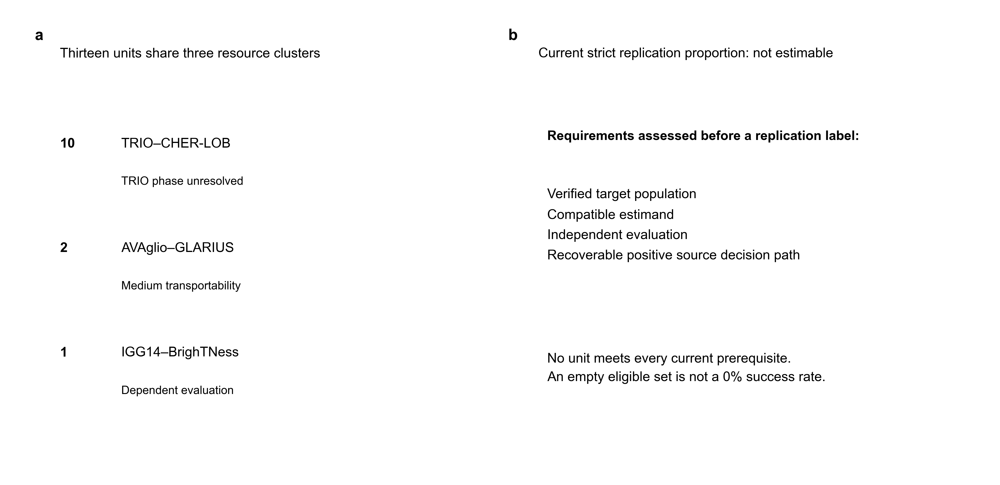
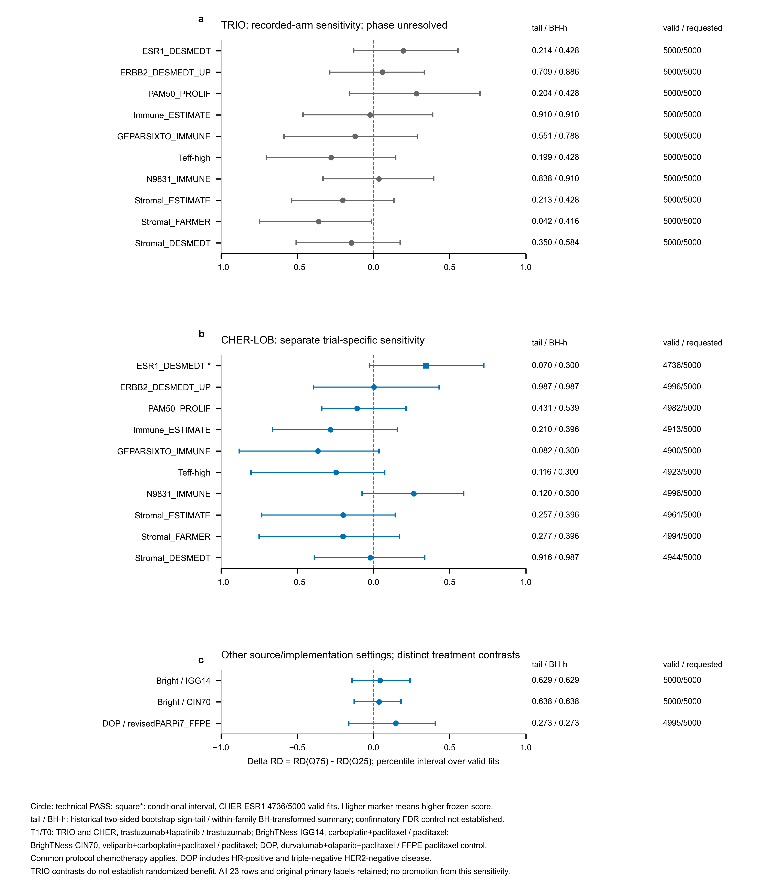
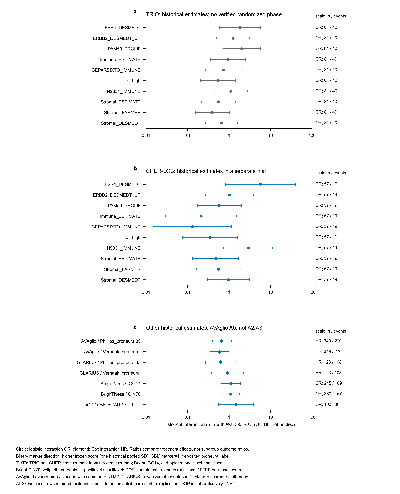

# Supplementary material

Zhi Chen and Teng Qi

Companion to manuscript candidate v1.6.2. Scientific records are unchanged. Author declarations are recorded in the main manuscript; individual contribution roles remain to be documented.

**Supplementary Figure S1 | Historical dependency clusters and current eligibility.** **a,** Thirteen historical units belong to three shared-resource clusters: ten TRIO/CHER-LOB, two AVAglio/GLARIUS and one IGG14/BrighTNess. They are not thirteen independent replication studies. **b,** Current strict eligibility requires verified target population, sufficient estimand compatibility, independent evaluation and a recoverable positive source decision path. No current unit satisfies every requirement, so the strict replication proportion is **not estimable**, not 0%, 0/13 or 0/0. Historic numerical labels are preserved separately from current eligibility (Supplementary Table S2).

**Supplementary Figure S2 | Historical absolute-effect sensitivities with explicit statistical limits.** **a,** Ten TRIO recorded-arm sensitivities do not establish verified randomized treatment benefit. **b,** Ten CHER-LOB calculations retain separate trial context. **c,** Two BrighTNess and one DOP model retain distinct comparisons. Points and bars show delta RD=RD(Q75)-RD(Q25) and historical percentile 95% intervals over valid within-recorded-arm bootstrap fits, with original pooled marker quartiles fixed. Positive values indicate a larger model-predicted T=1 minus T=0 contrast at Q75. Circle denotes technical PASS; square/asterisk denotes CHER ESR1_DESMEDT's conditional interval (4,736/5,000 valid fits). The right columns report historical two-sided sign-tail summaries, historical within-family BH transformations (BH-h), and valid/requested fits. Null calibration and confirmatory FDR control were not established. T=1/T=0 are trastuzumab+lapatinib/trastuzumab in TRIO and CHER-LOB; carboplatin+paclitaxel/paclitaxel for BrighTNess IGG14; veliparib+carboplatin+paclitaxel/paclitaxel for CIN70; and durvalumab+olaparib+paclitaxel/FFPE paclitaxel control for DOP, with common protocol chemotherapy as applicable. DOP includes HR-positive and triple-negative HER2-negative disease. All 23 rows and frozen primary labels remain unchanged; no additive result is promoted to replication.

**Supplementary Figure S3 | Complete historical primary estimates on distinct ratio scales.** **a,b,** Ten TRIO and ten CHER-LOB historical logistic interactions are displayed separately. **c,** The remaining seven rows include AVAglio historical A0, GLARIUS, two BrighTNess comparisons and DOP. Circles indicate interaction odds ratios; diamonds indicate Cox interaction hazard ratios; bars are the historical Wald 95% CIs. ORs and HRs are not pooled. Binary scores retain one historical pooled SD as their scale; GBM M=1 is deposited proneural, with M=0 all other labels, including Unclassified in AVAglio's frozen local coding. T=1/T=0 are specified within the figure: the HER2 dual/single contrast, separate BrighTNess B/C and A/C contrasts, DOP/FFPE control, AVAglio bevacizumab/placebo with common RT/TMZ, and GLARIUS bevacizumab+irinotecan/temozolomide with shared radiotherapy. TRIO allocation phase is unverified, GLARIUS is not exact AVAglio replication, and DOP is not exclusively TNBC. These 27 historical rows are not current strict replication verdicts; AVAglio A2/A3 remain in Figure 3.

## Supplementary tables

**Supplementary Table S1 | All 27 historical primary interaction rows.**

| Object | Trial | n/events | Scale | Interaction ratio (95% CI) | Historical P | Display qualification |
| --- | --- | --- | --- | --- | --- | --- |
| HER2_01 | TRIO-US B07 | 81/40 | OR | 1.836 (0.597–5.654) | 0.2894 | TRIO phase unverified |
| HER2_02 | TRIO-US B07 | 81/40 | OR | 1.250 (0.501–3.118) | 0.6328 | TRIO phase unverified |
| HER2_03 | TRIO-US B07 | 81/40 | OR | 2.008 (0.713–5.658) | 0.1871 | TRIO phase unverified |
| HER2_04 | TRIO-US B07 | 81/40 | OR | 0.946 (0.352–2.540) | 0.9122 | TRIO phase unverified |
| HER2_05 | TRIO-US B07 | 81/40 | OR | 0.743 (0.267–2.067) | 0.5687 | TRIO phase unverified |
| HER2_06 | TRIO-US B07 | 81/40 | OR | 0.536 (0.202–1.422) | 0.2104 | TRIO phase unverified |
| HER2_07 | TRIO-US B07 | 81/40 | OR | 1.105 (0.435–2.810) | 0.8334 | TRIO phase unverified |
| HER2_08 | TRIO-US B07 | 81/40 | OR | 0.563 (0.221–1.433) | 0.2281 | TRIO phase unverified |
| HER2_09 | TRIO-US B07 | 81/40 | OR | 0.397 (0.157–1.004) | 0.05089 | TRIO phase unverified |
| HER2_10 | TRIO-US B07 | 81/40 | OR | 0.654 (0.268–1.593) | 0.3495 | TRIO phase unverified |
| HER2_01 | CHER-LOB | 57/19 | OR | 5.699 (0.808–40.173) | 0.08071 | Trial-specific |
| HER2_02 | CHER-LOB | 57/19 | OR | 1.029 (0.267–3.960) | 0.9669 | Trial-specific |
| HER2_03 | CHER-LOB | 57/19 | OR | 0.581 (0.171–1.972) | 0.3836 | Trial-specific |
| HER2_04 | CHER-LOB | 57/19 | OR | 0.213 (0.030–1.516) | 0.1224 | Trial-specific |
| HER2_05 | CHER-LOB | 57/19 | OR | 0.130 (0.015–1.153) | 0.06697 | Trial-specific |
| HER2_06 | CHER-LOB | 57/19 | OR | 0.349 (0.075–1.618) | 0.1785 | Trial-specific |
| HER2_07 | CHER-LOB | 57/19 | OR | 2.893 (0.746–11.222) | 0.1245 | Trial-specific |
| HER2_08 | CHER-LOB | 57/19 | OR | 0.476 (0.133–1.700) | 0.2528 | Trial-specific |
| HER2_09 | CHER-LOB | 57/19 | OR | 0.555 (0.167–1.839) | 0.3355 | Trial-specific |
| HER2_10 | CHER-LOB | 57/19 | OR | 0.959 (0.298–3.087) | 0.9444 | Trial-specific |
| GBM_01 | AVAglio | 349/270 | HR | 0.667 (0.396–1.124) | 0.1287 | Historical AVA A0 |
| GBM_02 | AVAglio | 349/270 | HR | 0.586 (0.346–0.992) | 0.04679 | Historical AVA A0 |
| GBM_01 | GLARIUS | 123/108 | HR | 0.629 (0.271–1.463) | 0.2821 | Trial-specific |
| GBM_02 | GLARIUS | 123/108 | HR | 0.918 (0.379–2.222) | 0.8494 | Trial-specific |
| TNBC_01 | BrighTNess | 245/109 | OR | 1.086 (0.636–1.855) | 0.7616 | Trial-specific |
| TNBC_04 | BrighTNess | 360/167 | OR | 1.096 (0.673–1.784) | 0.7127 | Trial-specific |
| TNBC_03 | I-SPY2 DOP / GSE173839 | 100/36 | OR | 1.480 (0.553–3.956) | 0.4348 | Trial-specific |

Twenty-three rows are logistic ORs; four are Cox HRs. Ratios are not pooled. All original fields, including q values, evidence labels and source-stage records, are retained without alteration in Additional file 4A. Historical labels do not certify current strict replication. Treatment direction, scoring coverage and standardization are linked by object and trial in Table S4. Historical AVAglio A0 is distinct from the A2/A3 shared-set comparison in Table 2.

**Supplementary Table S2 | Thirteen dependent historical cross-trial units and current eligibility.**

| Object | Dependency cluster | Historical replay | Current strict member | Current classification |
| --- | --- | --- | --- | --- |
| GBM_01 | GBM_AVAGLIO_GLARIUS | NON_POSITIVE | FALSE | MEDIUM TRANSPORTABILITY  NOT STRICT EXACT REPLICATION |
| GBM_02 | GBM_AVAGLIO_GLARIUS | NON_POSITIVE | FALSE | MEDIUM TRANSPORTABILITY  NOT STRICT EXACT REPLICATION |
| HER2_01 | HER2_TRIO_B07_CHER_LOB | NON_POSITIVE | FALSE | PAIR POPULATION UNVERIFIED  DESCRIPTIVE ONLY |
| HER2_02 | HER2_TRIO_B07_CHER_LOB | NON_POSITIVE | FALSE | PAIR POPULATION UNVERIFIED  DESCRIPTIVE ONLY |
| HER2_03 | HER2_TRIO_B07_CHER_LOB | NON_POSITIVE | FALSE | PAIR POPULATION UNVERIFIED  DESCRIPTIVE ONLY |
| HER2_04 | HER2_TRIO_B07_CHER_LOB | NON_POSITIVE | FALSE | PAIR POPULATION UNVERIFIED  DESCRIPTIVE ONLY |
| HER2_05 | HER2_TRIO_B07_CHER_LOB | NON_POSITIVE | FALSE | PAIR POPULATION UNVERIFIED  DESCRIPTIVE ONLY |
| HER2_06 | HER2_TRIO_B07_CHER_LOB | NON_POSITIVE | FALSE | PAIR POPULATION UNVERIFIED  DESCRIPTIVE ONLY |
| HER2_07 | HER2_TRIO_B07_CHER_LOB | NON_POSITIVE | FALSE | PAIR POPULATION UNVERIFIED  DESCRIPTIVE ONLY |
| HER2_08 | HER2_TRIO_B07_CHER_LOB | NON_POSITIVE | FALSE | PAIR POPULATION UNVERIFIED  DESCRIPTIVE ONLY |
| HER2_09 | HER2_TRIO_B07_CHER_LOB | NON_POSITIVE | FALSE | PAIR POPULATION UNVERIFIED  DESCRIPTIVE ONLY |
| HER2_10 | HER2_TRIO_B07_CHER_LOB | NON_POSITIVE | FALSE | PAIR POPULATION UNVERIFIED  DESCRIPTIVE ONLY |
| TNBC_01 | TNBC_CALGB40603_BRIGHTNESS | NON_POSITIVE | FALSE | NEGATIVE LABEL ONLY REPLAY  FULL POSITIVE PATH UNRECOVERABLE |

There are three shared-resource clusters, not 13 independent studies. No unit meets every current prerequisite. The current strict replication proportion is NOT_ESTIMABLE rather than 0/13, 0/0 or 0%. Full historical labels, eligibility reasons and unchanged interpretation fields are retained in Additional file 4B.

**Supplementary Table S3 | All 23 historical absolute-effect sensitivities with statistical qualifications.**

| Object | Trial | ΔRD (percentile interval) | Historical sign-tail | Historical BH-h | Valid/requested | Technical status |
| --- | --- | --- | --- | --- | --- | --- |
| HER2_01 | TRIO-US B07 | 0.195 (−0.129, 0.555) | 0.214 | 0.4279 | 5000/5000 | PASS |
| HER2_02 | TRIO-US B07 | 0.059 (−0.287, 0.334) | 0.7091 | 0.8863 | 5000/5000 | PASS |
| HER2_03 | TRIO-US B07 | 0.282 (−0.157, 0.698) | 0.2044 | 0.4279 | 5000/5000 | PASS |
| HER2_04 | TRIO-US B07 | −0.022 (−0.462, 0.389) | 0.9102 | 0.9102 | 5000/5000 | PASS |
| HER2_05 | TRIO-US B07 | −0.121 (−0.587, 0.289) | 0.5515 | 0.7878 | 5000/5000 | PASS |
| HER2_06 | TRIO-US B07 | −0.278 (−0.702, 0.146) | 0.1988 | 0.4279 | 5000/5000 | PASS |
| HER2_07 | TRIO-US B07 | 0.036 (−0.331, 0.395) | 0.8382 | 0.9102 | 5000/5000 | PASS |
| HER2_08 | TRIO-US B07 | −0.202 (−0.537, 0.133) | 0.2128 | 0.4279 | 5000/5000 | PASS |
| HER2_09 | TRIO-US B07 | −0.360 (−0.748, −0.013) | 0.04159 | 0.4159 | 5000/5000 | PASS |
| HER2_10 | TRIO-US B07 | −0.145 (−0.507, 0.176) | 0.3503 | 0.5839 | 5000/5000 | PASS |
| HER2_01 | CHER-LOB | 0.344 (−0.026, 0.723) | 0.06966 | 0.3002 | 4736/5000 | WARN_CONDITIONAL_PERCENTILE |
| HER2_02 | CHER-LOB | 0.003 (−0.394, 0.431) | 0.9874 | 0.9874 | 4996/5000 | PASS |
| HER2_03 | CHER-LOB | −0.108 (−0.339, 0.214) | 0.4315 | 0.5393 | 4982/5000 | PASS |
| HER2_04 | CHER-LOB | −0.282 (−0.662, 0.157) | 0.2104 | 0.3958 | 4913/5000 | PASS |
| HER2_05 | CHER-LOB | −0.364 (−0.880, 0.036) | 0.08243 | 0.3002 | 4900/5000 | PASS |
| HER2_06 | CHER-LOB | −0.246 (−0.803, 0.074) | 0.1158 | 0.3002 | 4923/5000 | PASS |
| HER2_07 | CHER-LOB | 0.264 (−0.074, 0.592) | 0.1201 | 0.3002 | 4996/5000 | PASS |
| HER2_08 | CHER-LOB | −0.199 (−0.734, 0.144) | 0.2568 | 0.3958 | 4961/5000 | PASS |
| HER2_09 | CHER-LOB | −0.200 (−0.750, 0.171) | 0.2771 | 0.3958 | 4994/5000 | PASS |
| HER2_10 | CHER-LOB | −0.021 (−0.387, 0.336) | 0.9165 | 0.9874 | 4944/5000 | PASS |
| TNBC_01 | BrighTNess | 0.044 (−0.140, 0.240) | 0.6291 | 0.6291 | 5000/5000 | PASS |
| TNBC_04 | BrighTNess | 0.037 (−0.127, 0.181) | 0.6383 | 0.6383 | 5000/5000 | PASS |
| TNBC_03 | I-SPY2 DOP / GSE173839 | 0.147 (−0.162, 0.406) | 0.2726 | 0.2726 | 4995/5000 | PASS |

ΔRD=RD(Q75)−RD(Q25), at the original fixed pooled marker quartiles. Intervals use valid recorded-arm bootstrap fits. CHER-LOB ESR1_DESMEDT retains its conditional warning (4,736/5,000; 94.72%). Historical sign-tail and within-family BH-transformed summaries are descriptive: null calibration and confirmatory FDR control were not established. The original field names bootstrap_sign_p, bootstrap_bh_q_within_family and historical additive labels remain in Additional file 4C for reproducibility, but their names are not current confirmatory interpretations. Added review fields state the qualification. No absolute-effect result changes a frozen primary label. TRIO phase is unverified; DOP includes hormone-receptor-positive and TNBC HER2-negative disease. Exact comparison and standardization are in Table S4 and Additional file 1B.

**Supplementary Table S4 | All 27 local trial-specific implementation contexts.**

| Object | Trial | Provenance | n/events | Coverage | Standardization | T=1 minus T=0 |
| --- | --- | --- | --- | --- | --- | --- |
| HER2_01 | TRIO-US B07 | AUTHOR SCORE REUSED | 81/40 | Not asserted for reused score/label | pooled analytic sample z; ddof=1 | T1:Arm3 trastuzumab+lapatinib; T0:Arm1 trastuzumab; common protocol chemotherapy |
| HER2_02 | TRIO-US B07 | AUTHOR SCORE REUSED | 81/40 | Not asserted for reused score/label | pooled analytic sample z; ddof=1 | T1:Arm3 trastuzumab+lapatinib; T0:Arm1 trastuzumab; common protocol chemotherapy |
| HER2_03 | TRIO-US B07 | AUTHOR SCORE REUSED | 81/40 | Not asserted for reused score/label | pooled analytic sample z; ddof=1 | T1:Arm3 trastuzumab+lapatinib; T0:Arm1 trastuzumab; common protocol chemotherapy |
| HER2_04 | TRIO-US B07 | AUTHOR SCORE REUSED | 81/40 | Not asserted for reused score/label | pooled analytic sample z; ddof=1 | T1:Arm3 trastuzumab+lapatinib; T0:Arm1 trastuzumab; common protocol chemotherapy |
| HER2_05 | TRIO-US B07 | AUTHOR SCORE REUSED | 81/40 | Not asserted for reused score/label | pooled analytic sample z; ddof=1 | T1:Arm3 trastuzumab+lapatinib; T0:Arm1 trastuzumab; common protocol chemotherapy |
| HER2_06 | TRIO-US B07 | AUTHOR SCORE REUSED | 81/40 | Not asserted for reused score/label | pooled analytic sample z; ddof=1 | T1:Arm3 trastuzumab+lapatinib; T0:Arm1 trastuzumab; common protocol chemotherapy |
| HER2_07 | TRIO-US B07 | AUTHOR SCORE REUSED | 81/40 | Not asserted for reused score/label | pooled analytic sample z; ddof=1 | T1:Arm3 trastuzumab+lapatinib; T0:Arm1 trastuzumab; common protocol chemotherapy |
| HER2_08 | TRIO-US B07 | AUTHOR SCORE REUSED | 81/40 | Not asserted for reused score/label | pooled analytic sample z; ddof=1 | T1:Arm3 trastuzumab+lapatinib; T0:Arm1 trastuzumab; common protocol chemotherapy |
| HER2_09 | TRIO-US B07 | AUTHOR SCORE REUSED | 81/40 | Not asserted for reused score/label | pooled analytic sample z; ddof=1 | T1:Arm3 trastuzumab+lapatinib; T0:Arm1 trastuzumab; common protocol chemotherapy |
| HER2_10 | TRIO-US B07 | AUTHOR SCORE REUSED | 81/40 | Not asserted for reused score/label | pooled analytic sample z; ddof=1 | T1:Arm3 trastuzumab+lapatinib; T0:Arm1 trastuzumab; common protocol chemotherapy |
| HER2_01 | CHER-LOB | LOCAL SOURCE COMPATIBLE SCORE | 57/19 | 238/263 | pooled A/C analytic sample z; ddof=1 | T1:C trastuzumab+lapatinib; T0:A trastuzumab; common trial chemotherapy |
| HER2_02 | CHER-LOB | LOCAL SOURCE COMPATIBLE SCORE | 57/19 | 20/23 | pooled A/C analytic sample z; ddof=1 | T1:C trastuzumab+lapatinib; T0:A trastuzumab; common trial chemotherapy |
| HER2_03 | CHER-LOB | LOCAL SOURCE COMPATIBLE SCORE | 57/19 | 10/11 | pooled A/C analytic sample z; ddof=1 | T1:C trastuzumab+lapatinib; T0:A trastuzumab; common trial chemotherapy |
| HER2_04 | CHER-LOB | LOCAL SOURCE COMPATIBLE SCORE | 57/19 | 141/141 | pooled A/C analytic sample z; ddof=1 | T1:C trastuzumab+lapatinib; T0:A trastuzumab; common trial chemotherapy |
| HER2_05 | CHER-LOB | LOCAL SOURCE COMPATIBLE SCORE | 57/19 | 12/12 | pooled A/C analytic sample z; ddof=1 | T1:C trastuzumab+lapatinib; T0:A trastuzumab; common trial chemotherapy |
| HER2_06 | CHER-LOB | LOCAL SOURCE COMPATIBLE SCORE | 57/19 | 3/3 | pooled A/C analytic sample z; ddof=1 | T1:C trastuzumab+lapatinib; T0:A trastuzumab; common trial chemotherapy |
| HER2_07 | CHER-LOB | LOCAL SOURCE COMPATIBLE SCORE | 57/19 | 11/13 | pooled A/C analytic sample z; ddof=1 | T1:C trastuzumab+lapatinib; T0:A trastuzumab; common trial chemotherapy |
| HER2_08 | CHER-LOB | LOCAL SOURCE COMPATIBLE SCORE | 57/19 | 137/141 | pooled A/C analytic sample z; ddof=1 | T1:C trastuzumab+lapatinib; T0:A trastuzumab; common trial chemotherapy |
| HER2_09 | CHER-LOB | LOCAL SOURCE COMPATIBLE SCORE | 57/19 | 47/50 | pooled A/C analytic sample z; ddof=1 | T1:C trastuzumab+lapatinib; T0:A trastuzumab; common trial chemotherapy |
| HER2_10 | CHER-LOB | LOCAL SOURCE COMPATIBLE SCORE | 57/19 | 65/68 | pooled A/C analytic sample z; ddof=1 | T1:C trastuzumab+lapatinib; T0:A trastuzumab; common trial chemotherapy |
| GBM_01 | AVAglio | DEPOSITED LABEL REUSED | 349/270 | Not asserted for reused score/label | binary proneural=1, other deposited labels=0; no z-standardization | T1:bevacizumab+RT/TMZ; T0:placebo+RT/TMZ |
| GBM_02 | AVAglio | DEPOSITED LABEL REUSED | 349/270 | Not asserted for reused score/label | binary proneural=1, other deposited labels=0; no z-standardization | T1:bevacizumab+RT/TMZ; T0:placebo+RT/TMZ |
| GBM_01 | GLARIUS | DEPOSITED LABEL REUSED | 123/108 | Not asserted for reused score/label | binary proneural=1, other deposited labels=0; no z-standardization | T1:bevacizumab+irinotecan regimen; T0:temozolomide regimen; shared radiotherapy |
| GBM_02 | GLARIUS | DEPOSITED LABEL REUSED | 123/108 | Not asserted for reused score/label | binary proneural=1, other deposited labels=0; no z-standardization | T1:bevacizumab+irinotecan regimen; T0:temozolomide regimen; shared radiotherapy |
| TNBC_01 | BrighTNess | LOCAL AVAILABLE GENE MEAN | 245/109 | 11/14 | pooled B/C z; ddof=0 | T1:B carboplatin+paclitaxel; T0:C paclitaxel; subsequent common chemotherapy |
| TNBC_04 | BrighTNess | LOCAL SOURCE COMPATIBLE SCORE | 360/167 | 70/70 | pooled A/C z; ddof=1 | T1:A veliparib+carboplatin+paclitaxel; T0:C paclitaxel; subsequent common chemotherapy |
| TNBC_03 | I-SPY2 DOP / GSE173839 | AUTHOR SCORE REUSED | 100/36 | Not asserted for reused score/label | pooled known-pCR records z; ddof=0 | T1:durvalumab+olaparib+paclitaxel; T0:FFPE control paclitaxel; subsequent common AC |

These 27 contexts link to 15 objects. Ten TRIO and ten CHER-LOB contexts share ten object IDs, but have different implementation pathways. CHER-LOB input/loader identity is confirmed while final generation lineage remains incompletely recovered. Coverage denotes mapped available genes, not certification of normalization, calibration or whole-assay equivalence. Blank coverage for score or label reuse is not zero coverage. Historical AVAglio rows refer to A0. Actual input hashes, loader identity, limits and unchanged historical fidelity records are retained in the local-review Additional file 1B. Local paths in that file require removal before any future public release. Seven source-only objects have no local fits.
